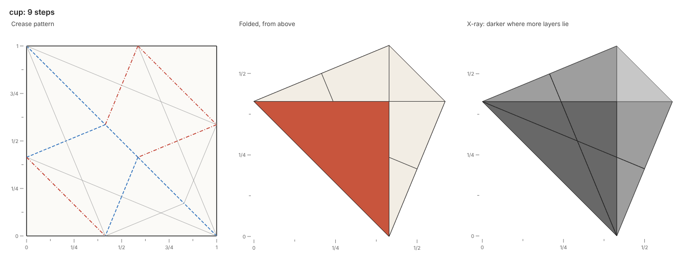

# origamy

A compiler for origami, built for AI agents.



An AI agent writes an origami model as a Python fold script, and origamy folds it step by step on a simulated sheet.
Each action either happens or is refused with the facts of why, at the script line that asked for it.
Every build draws the crease pattern, the folded paper and an x-ray of its layers, and exports a FOLD file.

The tool is a simulator and a compiler at once.
No list of legal moves exists: the agent proposes any fold, and origamy says exactly what happens.
Coordinates are exact numbers of the form a + b√2, so every check is exact, down to the 22.5° angles of the bird base.

## Install

Python 3.14 or newer runs origamy, and a Chromium draws its pictures.

```sh
uv init --bare --pin-python --python 3.14 my-models  # a project for your fold scripts
cd my-models
uv add git+https://github.com/maxencefaldor/origamy#subdirectory=packages/origamy
uv run playwright install chromium                   # the browser origamy draws in, once per machine
```

## Fold a model

A fold script defines `fold()`, which folds a `Paper` and returns it.
Coordinates are where the paper lies now, seen from above, with the unfolded square from (0, 0) to (1, 1).
Each fold takes a line and a flap point: the paper at that point, and everything joined to it on its side of the line, turns over the line.

```python
from origamy import Line, Paper


def fold() -> Paper:
    paper = Paper.square()
    paper.valley(Line.through(("1/2", 0), ("1/2", 1)), flap=("3/4", "1/2"))
    paper.valley(Line.through((0, "1/2"), ("1/2", "1/2")), flap=("1/4", "3/4"))
    return paper
```

Build it with `uv run origamy build square.py`:

```text
square.py: 2 steps folded
wrote square.fold, square.png, square.steps.png
```

The picture `square.png` shows the paper at the end, and `square.steps.png` shows every step with the next fold line dashed, as diagrams do.
The [cup example](examples/cup.py) folds a traditional paper cup with exact constructions.

## Feedback is facts

A refused action stops the build at its line, and the picture shows the paper just before it, with the fold line and the faces involved.

```text
broken.py: 1 step folded, then step 2 refused
warn[unreferenced-fold] step 2, valley: broken.py:7 in fold(): no point or line on the paper locates the fold line x = 2
error[no-hinge] step 2, valley fold along x = 2, the paper at (1/4, 1/2): broken.py:7 in fold(): the paper to move meets no other paper along x = 2
  faces: 0, 1
```

The command `uv run origamy explain` lists every rule with its level and exact condition.

| Rule | Level | Fact |
| --- | --- | --- |
| `flap-off-paper`, `flap-on-line` | error | The flap point names no paper to move |
| `too-few-layers` | error | Fewer layers lie at the flap point than the action takes |
| `no-hinge` | error | The paper to move is joined to no other paper along the fold line |
| `already-folded`, `not-folded` | error | A fold runs along a crease already folded, or an unfold along flat paper |
| `layer-crossing` | error | No stacking of the faces keeps paper from passing through paper |
| `layer-order-unknown` | error | The layer solver stopped before finding a stacking |
| `unreferenced-fold` | warn | No point or line already on the paper locates the fold line |

## How it works

The state of the paper is its crease pattern, where each face lies, and which face is above wherever two overlap.
A fold reflects the faces it moves across its line, exactly.
The layer solver then finds how the faces stack, after the constraints of [Flat-Folder](https://erikdemaine.org/papers/FlatFolder_OSME2024/paper.pdf): taco-taco, taco-tortilla, tortilla-tortilla and transitivity.
The paper that stays keeps its order, the paper that moves reverses its own, and a valley fold lands it on top or a mountain fold underneath.
When no stacking exists, origamy names the constraints that conflict.

## Status

The project is in its first phase: exact folds, unfolds, precreases and turns, with the layer solver, pictures and FOLD export.
Collapses, which fold many creases at once as squash and petal folds do, come next.

## License

Apache-2.0.
