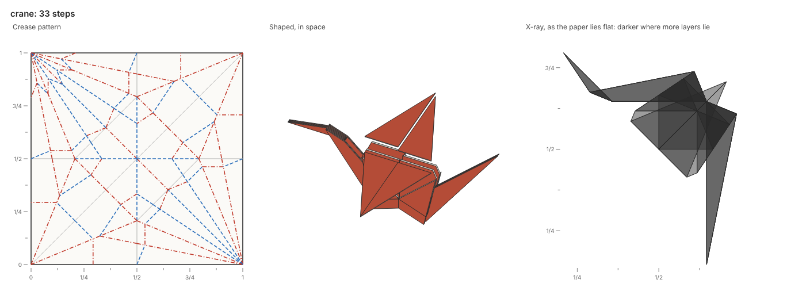
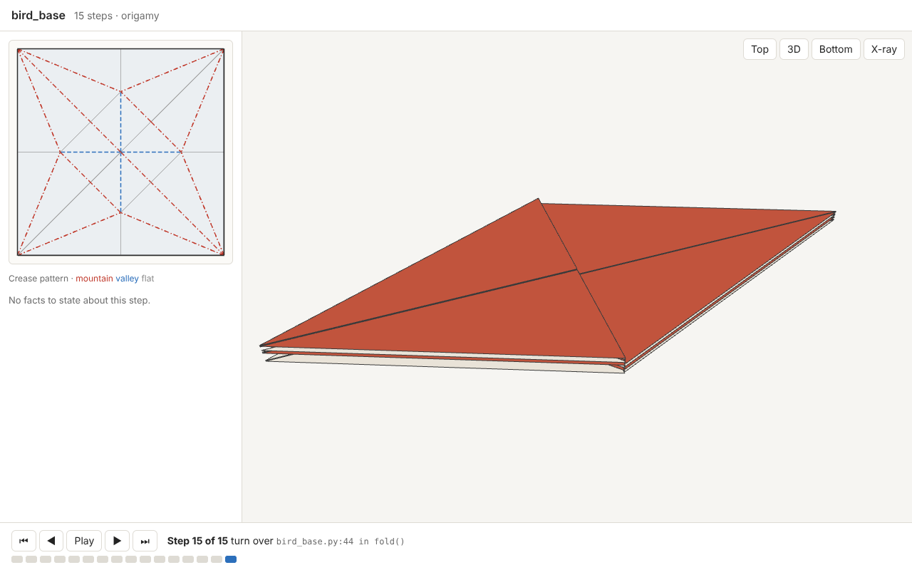
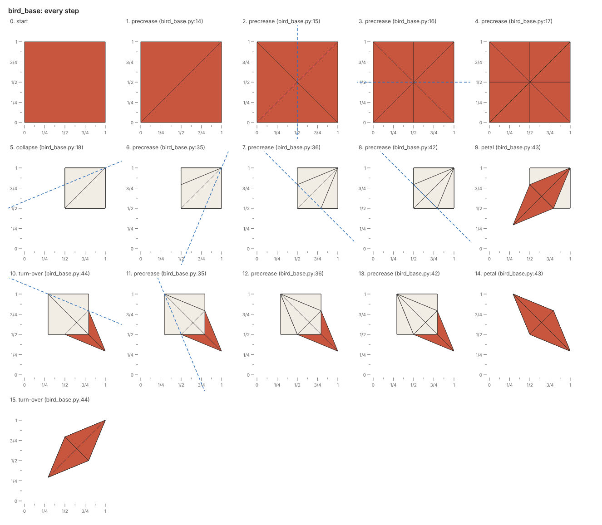

# origamy

A compiler for origami, built for AI agents.



An AI agent writes an origami model as a Python fold script, and origamy folds it step by step on a simulated sheet.
Each action either happens or is refused with the facts of why, at the script line that asked for it.
Every build draws the crease pattern, the folded paper and an x-ray of its layers, and exports a FOLD file.

The tool is a simulator and a compiler at once.
No list of legal moves exists: the agent proposes any fold, and origamy says exactly what happens.
Coordinates are exact numbers built from the rationals by square roots, so every check is exact.
The 22.5° angles of the bird base, the 11.25° creases of a crane, and any angle bisected all stay exact.

The [documentation](https://maxencefaldor.github.io/origamy/) teaches the fold scripts, the actions and the rules.
The [gallery](https://maxencefaldor.github.io/origamy/gallery/) opens each example in the 3D viewer: classics such as the crane and the paper plane, bases, and original models.

## Install

Python 3.14 or newer runs origamy, a Rust toolchain builds its simulator, and a Chromium draws its pictures.

```sh
uv init --bare --pin-python --python 3.14 my-models  # a project for your fold scripts
cd my-models
uv add git+https://github.com/maxencefaldor/origamy#subdirectory=packages/origamy
uv run playwright install chromium                   # the browser origamy draws in, once per machine
```

## Fold a model

A fold script defines `fold()`, which folds a `Paper` and returns it.
Coordinates are where the paper lies now, seen from above, with the unfolded square from (0, 0) to (1, 1).
Each fold takes a line and a flap point.
The paper at that point, and everything joined to it on its side of the line, turns over the line.

```python
from origamy import Line, Paper


def fold() -> Paper:
    paper = Paper.square()
    paper.valley(Line.through(("1/2", 0), ("1/2", 1)), flap=("3/4", "1/2"))
    paper.valley(Line.through((0, "1/2"), ("1/2", "1/2")), flap=("1/4", "3/4"))
    return paper
```

Build it with `uv run origamy build square.py`:

```text
square.py: 2 steps folded
wrote square.fold, square.png, square.steps.png, square.html
```

The picture `square.png` shows the paper at the end, and `square.steps.png` shows every step with the next fold line dashed, as diagrams do.
The [cup example](examples/cup.py) folds a traditional paper cup with exact constructions.

## Viewer

Every build also writes a standalone page, such as `square.html`, that replays the fold in 3D.
The viewer shows the crease pattern beside the folded paper, and animates each step with the paper whole.
Each folded edge bends round, and people can orbit, view from above or below, and see through the layers.
Hovering a face lights it in both views, and each step names its script line and its facts.



## Collapse

A collapse folds, unfolds or reverses many creases at once, along creases already in the paper.
Creases read as on the crease pattern: whole lines, or segments given by their two ends, with mountains and valleys seen from the paper's front.
The [preliminary base](examples/preliminary_base.py) precreases four lines through the center, then collapses them in one step:

```python
paper.collapse(valleys=[upright, level], mountains=[falling])
```

Two queries find the creases to name.
`paper.creases(line)` gives the creases lying along a line now, as crease pattern segments.
`paper.origin(point)` gives where a point of the top layer lies on the unfolded paper.
Before folding, a collapse checks every vertex with Maekawa's and Kawasaki's theorems, and the layer solver checks every stacking.

## Named moves

Named moves compute their creases and collapse in one step, judged like any collapse.

| Move | What it does |
| --- | --- |
| `paper.reverse(line, flap)` | Turns the tip of a folded flap inside out between its two halves; `outside=True` wraps it around them |
| `paper.petal(line, flap)` | Lifts the top layer over a line while its sides fold in along precreased creases |

The [bird base](examples/bird_base.py) collapses a preliminary base, then petal folds each side:



## Shape

Shaping opens folds part of the way, as hands spread a crane's wings, so the model leaves the table.
Three actions shape paper in space.
A shape step turns paper about its hinge by an angle, and a flex folds creases that meet at a vertex together.
A tilt holds the model up:

```python
paper.shape(shoulders, flap=wing, angle=90, layers=1)
paper.tilt(shoulders, flap=tail, angle=90)
```

The pictures, the viewer and the FOLD file then show the model in space, with every crease's fold angle.

## Connect an agent

The package `origamy-mcp` serves origamy over the Model Context Protocol, so any agent harness can fold.
From a clone of this repository, Claude Code adds it with one command:

```sh
claude mcp add origamy -- uv run --directory /path/to/origamy origamy-mcp
```

The tool `fold_model` runs a fold script and answers with the report and both pictures.
The tool `view_model` draws any step in 3D from any direction, and `explain_rule` gives a rule's exact condition.
The skill in [.claude/skills/fold-model](.claude/skills/fold-model/SKILL.md) teaches the loop, the coordinates and the actions, and no designs.

## Feedback is facts

A refused action stops the build at its line.
The picture shows the paper the action began on, with the fold line and the faces involved.

```text
broken.py: 1 step folded, then step 2 refused
warn[unreferenced-fold] step 2, valley fold along x = 2, the paper at (1/4, 1/2): broken.py:7 in fold(): no point or line on the paper locates the fold line x = 2
error[no-hinge] step 2, valley fold along x = 2, the paper at (1/4, 1/2): broken.py:7 in fold(): the paper to move meets no other paper along x = 2
  faces: 0, 1
```

The command `uv run origamy explain` lists every rule with its level and exact condition.

| Rule | Level | Fact |
| --- | --- | --- |
| `flap-off-paper`, `flap-on-line` | error | The flap point names no paper to move |
| `too-few-layers` | error | Fewer layers lie at the flap point than the action takes |
| `no-hinge` | error | The paper to move is joined to no other paper along the fold line |
| `already-folded`, `not-folded` | error | A fold turns a crease already folded that way, or an unfold turns flat paper |
| `no-crease` | error | A collapse names a line with no crease of the paper along it |
| `no-side` | error | The layer a petal fold lifts has no folded side to open |
| `no-spine`, `several-spines` | error | A reverse fold's tip opens into two halves in no way, or in several equally even ways |
| `mountain-valley-count` | error | Mountains and valleys at a vertex do not differ by two |
| `unbalanced-angles` | error | The angles between folds at a vertex do not alternate to 180° |
| `layer-crossing` | error | No stacking of the faces keeps paper from passing through paper |
| `layer-order-unknown` | error | The layer solver stopped before finding a stacking |
| `not-flat` | error | The action folds paper that shaping has turned out of the plane |
| `hinge-bent` | error | The hinge of a shape step runs through paper turned apart before |
| `turns-through-paper` | error | A shape step or a flex turns paper through paper |
| `no-flex` | error | No rigid motion turns the creases to the angles a flex names |
| `unreferenced-fold` | warn | No point or line already on the paper locates the fold line |

## How it works

The state of the paper is its crease pattern, where each face lies, and which face is above wherever two overlap.
Coordinates are exact numbers in a tower of square roots, so every crease a construction finds is exact.
Float estimates with error bounds decide most signs fast, and exact arithmetic decides the rest.
A fold reflects the faces it moves across its line.
A collapse places each face by the reflections across the folds between it and a fixed face.
The layer solver then finds how the faces stack, after the constraints of [Flat-Folder](https://erikdemaine.org/papers/FlatFolder_OSME2024/paper.pdf): taco-taco, taco-tortilla, tortilla-tortilla and transitivity.
The paper that stays keeps its order, and the paper that moves reverses its own.
A valley fold lands the moving paper on top, and a mountain fold underneath.
A collapse moves the paper as little through itself as it can: each face that turns about a fold lands beside the face across it.
When no stacking exists, origamy names the constraints that conflict.

## Status

The project is in its first phase.
The phase covers exact folds, unfolds, precreases, collapses, reverse and petal folds, and shaping.
The layer solver, pictures, a 3D viewer, an MCP server and FOLD export complete it.
The [crane](examples/crane.py) folds end to end, from the square to its wings spread in space.
Squash and sink folds, and shaping that bends paper as well as folding it, come next.

## License

Apache-2.0.
