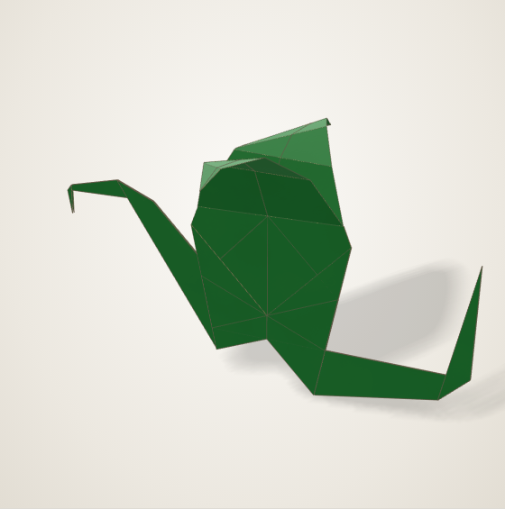
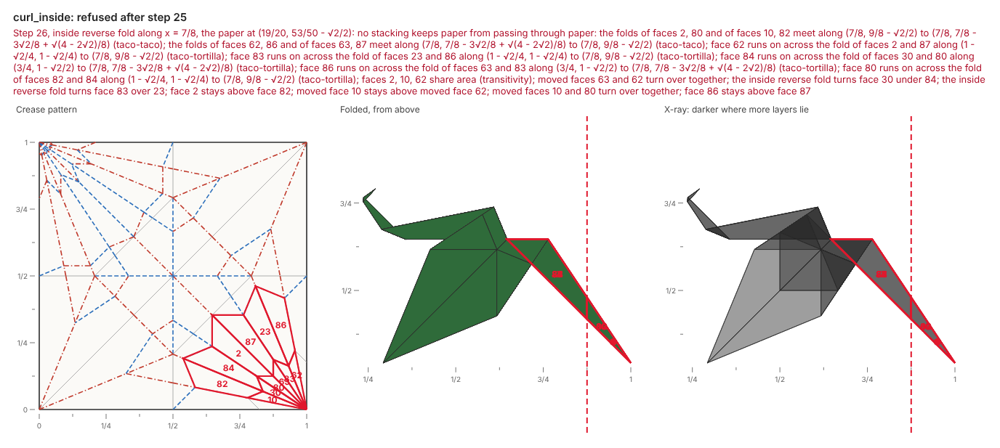
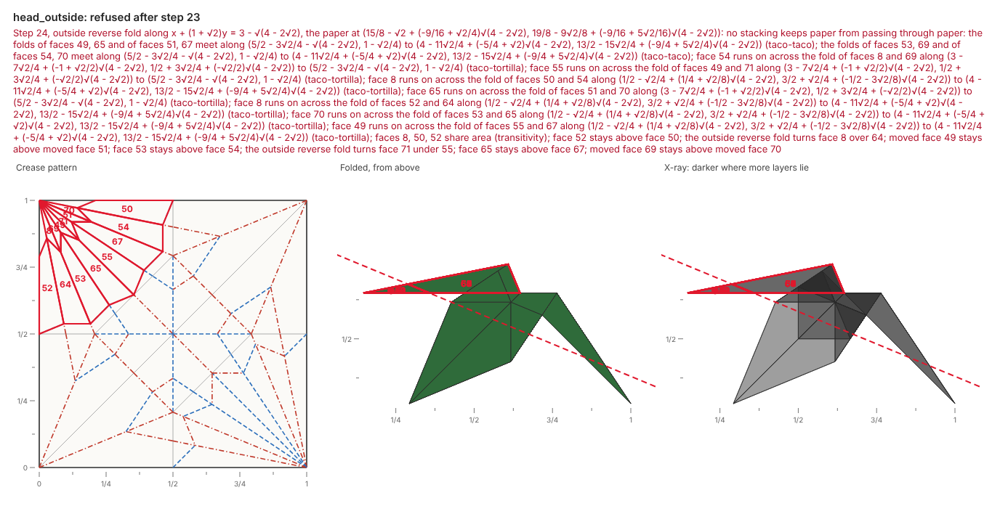
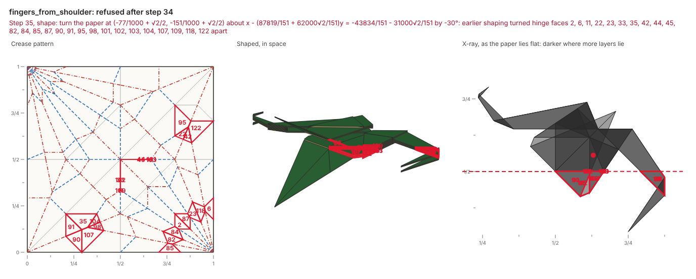
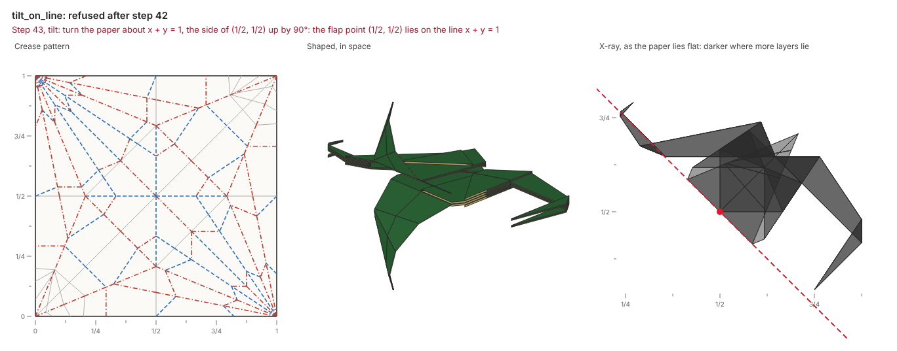

# Designing a dragon

The dragon in the [gallery](../gallery.md#originals) is an original model, designed by an agent through the fold loop.
The agent wrote [`examples/dragon.py`](https://github.com/maxencefaldor/origamy/blob/main/examples/dragon.py), built it, read the report and the pictures, and changed the script.
This page replays four refusals from that session, each as origamy stated it, and the change that answered it.

{ width="420" }

## The plan

The dragon starts from a bird base, as the crane does, and keeps the crane's narrowed legs.
One leg reverse folds up into a neck, and the other reverses straight back into a tail.
The head reverse folds forward from the top of the neck, the tail's tip curls up, and the wings rise and arch.
Last, a tilt stands the dragon up on its belly.

## The tail's tip will not curl inside

The first script curled the tail's last eighth up with an inside reverse fold.
The paper refused it:

```text
dragon.py: 25 steps folded, then step 26 refused
error[layer-crossing] step 26, inside reverse fold along x = 7/8, the paper at (19/20, 53/50 - √2/2): dragon.py:80 in fold(): no stacking keeps paper from passing through paper: the folds of faces 2, 80 and of faces 10, 82 meet along (7/8, 9/8 - √2/2) to (7/8, 7/8 - 3√2/8 + √(4 - 2√2)/8) (taco-taco); …
  faces: 2, 10, 23, 30, 62, 63, 80, 82, 83, 84, 86, 87
```

The picture outlines the refused faces in red, on the crease pattern and on the folded paper.
The tip would turn up between the tail's layers, through folds that already wrap them.



An outside reverse fold wraps the tip round the tail's layers instead, and the paper takes it.
The script changed one argument: `outside=True`.

## The head will not wrap outside

The next script made the head with an outside reverse fold, along the crane's head line.
That fold wraps the head round the neck, and the head would pass through the wing behind it:

```text
dragon.py: 23 steps folded, then step 24 refused
error[layer-crossing] step 24, outside reverse fold along x + (1 + √2)y = 3 - √(4 - 2√2), …: dragon.py:67 in fold(): no stacking keeps paper from passing through paper: …
  faces: 8, 49, 50, 51, 52, 53, 54, 55, 64, 65, 67, 69, 70, 71
```



The head kept the crane's inside reverse fold.
Its snout then hooks down with a second, outside reverse fold, near the head's tip, where no wing lies behind it.

## The wings will not bend across the shoulder

Each wing rises at its shoulder, then arches down at three fingers.
A first script ran the fingers from the middle of the shoulder, so each finger's line crossed the shoulder crease:

```text
dragon.py: 34 steps folded, then step 35 refused
error[hinge-bent] step 35, shape: turn the paper at (-77/1000 + √2/2, -151/1000 + √2/2) about … by -30°: dragon.py:105 in fold(): earlier shaping turned hinge faces 2, 6, 11, 22, 23, 33, … apart
```

A shape step turns paper about a hinge, and earlier shaping had already turned the shoulder's faces apart.
No straight hinge runs through faces that no longer lie in one plane.



The fingers moved to start from a wrist on each wing's leading edge.
Their lines then cross only the wing, and each turns the membrane beyond it down by 30°.

## The tilt needs a side

The last step stands the dragon up: a tilt about the shoulders' line, turning one side of it up by 90°.
The first script named the paper's center as that side:

```text
dragon.py: 42 steps folded, then step 43 refused
error[flap-on-line] step 43, tilt: turn the paper about x + y = 1, the side of (1/2, 1/2) up by 90°: dragon.py:110 in fold(): the flap point (1/2, 1/2) lies on the line x + y = 1
```



The center lies on the shoulders' line, so it names neither side.
The script moved the flap point a sixteenth of the paper toward the neck.

## What the pictures caught

Some mistakes are no refusals: the paper takes the action, and only the pictures show the model is wrong.
An early tilt named the tail's tip as the side to raise, after a reverse fold had moved the tip across the shoulders' line.
The paper took the tilt, and the dragon stood on its back, wings down.
The agent saw it in 3D views of the build, as the [fold-model skill](connect.md#skill) asks, and named a point of the body instead.

Wings that rise 125° and turn up, then down, then up at their fingers also built without a refusal.
From the side, their two points stood up like a cat's ears.
Raising the wings to 150° and turning the membrane down at every finger arched them over the body, as a bat's wings arch.

## The result

The final script builds in 43 steps with no refusal.
The gallery plays it as origamy's simulator folds it, each step resting exactly in its state.
Five of its folds and shape steps carry the warning `unreferenced-fold`.
Their lines, such as the fingers, pass through no point the paper already marks, so a person folding the dragon judges them by eye.
