# Gallery

The models below each fold with one command from [`examples/`](https://github.com/maxencefaldor/origamy/tree/main/examples).
Each opens in the 3D viewer, to replay its steps, orbit the paper and see every layer in x-ray.
The viewer opens in its studio, lighting the paper as paper; its Studio button turns the view into a diagram.
Each viewer plays the model exactly as origamy's simulator folds it from the flat sheet: kami with its thickness, each crease curling round the layers it wraps.
The viewer also traces each face back to the crease pattern.

## Birds and insects

Models with wings, shaped out of the plane to stand or spread.

-   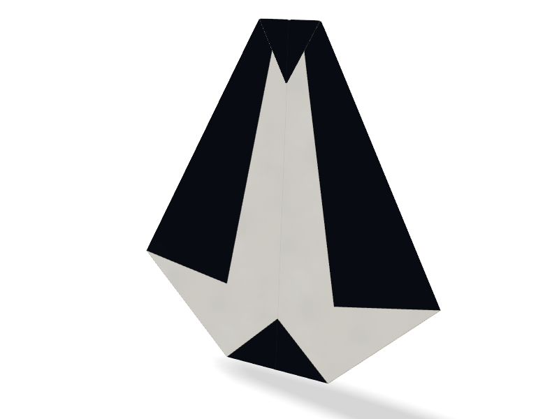

    **[Penguin](gallery/penguin.html)** · 7 steps

    A kite, its white side up, whose sides stop short of the spine, so a white belly shows between black wings.
    The feet fold up and the head down, both black, and the penguin stands on its feet.

    [Open in 3D](gallery/penguin.html) · [Script](https://github.com/maxencefaldor/origamy/blob/main/examples/penguin.py)

## Animals and faces

Heads and bodies folded flat, then stood up or lifted into relief.

-   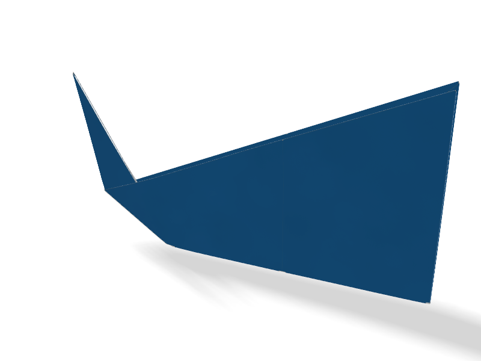

    **[Whale](gallery/whale.html)** · 8 steps

    A kite whose blunt corner folds over as the head, halved along its spine.
    The tail reverse folds up between the body's layers, and the whale stands on its belly.

    [Open in 3D](gallery/whale.html) · [Script](https://github.com/maxencefaldor/origamy/blob/main/examples/whale.py)

-   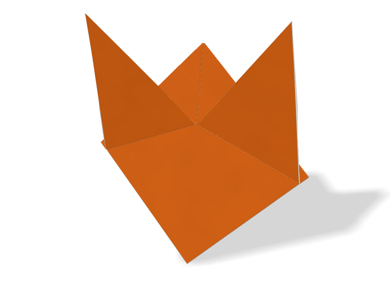

    **[Fox face](gallery/fox-face.html)** · 8 steps

    A triangle whose corners fold down to the chin, then back up past the head as ears.
    Each ear's fold runs from the bottom edge to the spine, never across the flap's hinge.
    The ears lean 25° forward, and the face stands on its chin.

    [Open in 3D](gallery/fox-face.html) · [Script](https://github.com/maxencefaldor/origamy/blob/main/examples/fox_face.py)

-   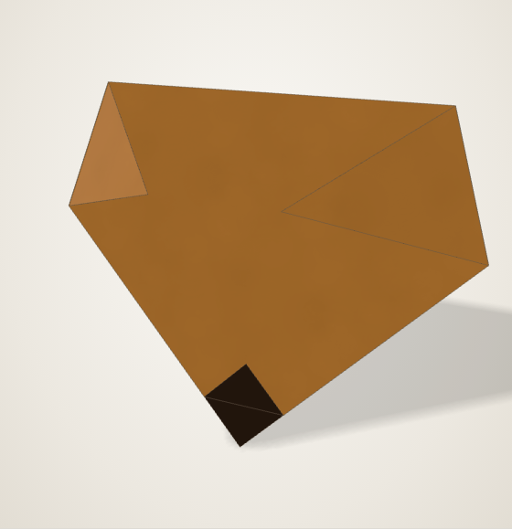

    **[Dog face](gallery/dog-face.html)** · 7 steps

    A triangle whose corners fold down as ears, the chin's tip turned up as the nose.
    The ears lift 35° off the face, and the face stands on its chin.

    [Open in 3D](gallery/dog-face.html) · [Script](https://github.com/maxencefaldor/origamy/blob/main/examples/dog_face.py)

-   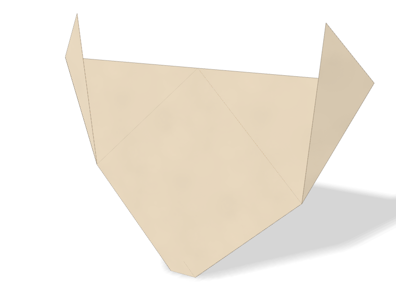

    **[Cat face](gallery/cat-face.html)** · 9 steps

    A triangle whose corners fold up past its top as ears, square to the head's axis.
    Each ear turns about its side's middle, and the chin's tip tucks behind.
    The ears lean 30° forward, and the face stands on its chin.

    [Open in 3D](gallery/cat-face.html) · [Script](https://github.com/maxencefaldor/origamy/blob/main/examples/cat_face.py)

## Things

Traditional toys and objects, each ending in space.

-   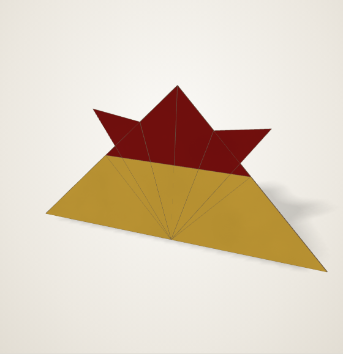

    **[Samurai helmet](gallery/samurai-helmet.html)** · 11 steps

    The kabuto: a triangle whose corners fold down, then up and out as horns.
    The brim rolls up twice over the horns' roots, and the helmet stands on it.

    [Open in 3D](gallery/samurai-helmet.html) · [Script](https://github.com/maxencefaldor/origamy/blob/main/examples/samurai_helmet.py)

-   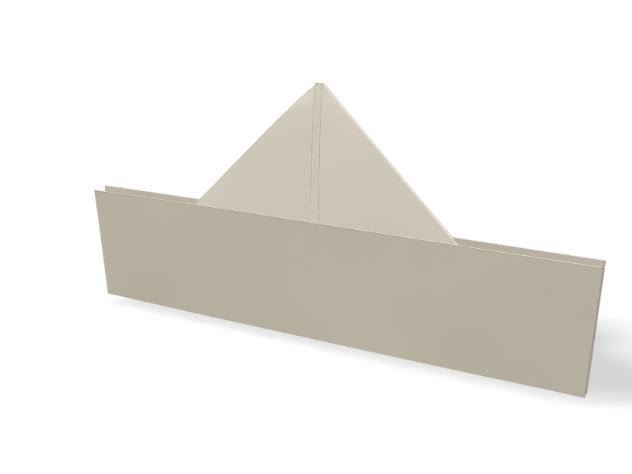

    **[Newspaper hat](gallery/newspaper-hat.html)** · 8 steps

    A sheet twice as tall as wide, halved, its top corners folded down to the middle.
    Each brim rolls up twice, the front over the corners and the back behind them.

    [Open in 3D](gallery/newspaper-hat.html) · [Script](https://github.com/maxencefaldor/origamy/blob/main/examples/newspaper_hat.py)

-   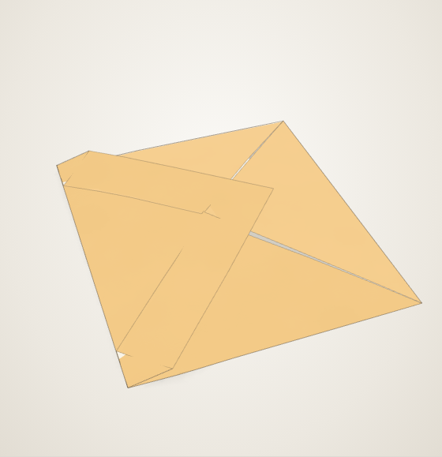

    **[Envelope](gallery/envelope.html)** · 4 steps

    A square on its corner: its side corners fold to the center, and its bottom corner folds up past it.
    The top corner folds down over them as the flap.

    [Open in 3D](gallery/envelope.html) · [Script](https://github.com/maxencefaldor/origamy/blob/main/examples/envelope.py)

## Planes

Paper planes whose wings spread level from the body.

-   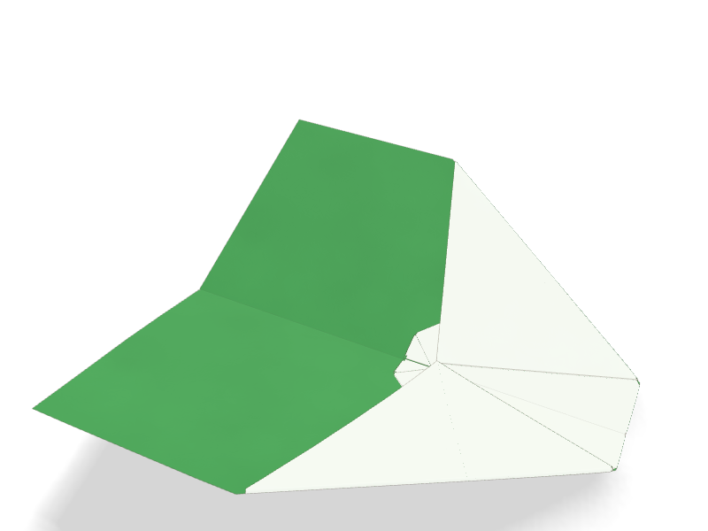

    **[Nakamura lock](gallery/nakamura-lock.html)** · 9 steps

    A paper plane whose nose folds down, then whose corners fold to the keel above the nose's tip.
    The tip folds up over the corners and locks them.
    The wings stay open, raised in a shallow V about the keel.

    [Open in 3D](gallery/nakamura-lock.html) · [Script](https://github.com/maxencefaldor/origamy/blob/main/examples/nakamura_lock.py)

## Classics

Traditional models folded step by step as diagrams teach them, with every crease exact.

-   

    **[Tulip](gallery/tulip.html)** · 3 steps

    A triangle whose bottom corners rise past its top as petals, each 22.5° off the flower's axis.
    Each petal's tip lies on a bisector at the base's middle, and its fold bisects the angle from its corner to that tip.

    [Open in 3D](gallery/tulip.html) · [Script](https://github.com/maxencefaldor/origamy/blob/main/examples/tulip.py)

-   

    **[Heart](gallery/heart.html)** · 10 steps

    A square on its corner: the top corner folds to the center and the bottom corner up to the top edge.
    The bottom edges fold up onto the axis as the heart's point, and the lobes' corners fold behind.

    [Open in 3D](gallery/heart.html) · [Script](https://github.com/maxencefaldor/origamy/blob/main/examples/heart.py)

-   

    **[Fortune teller](gallery/fortune-teller.html)** · 13 steps

    Corners to the center on both sides, then folded in half: the flat form before the fingers go in.
    The diagonals, creased first, locate every fold.

    [Open in 3D](gallery/fortune-teller.html) · [Script](https://github.com/maxencefaldor/origamy/blob/main/examples/fortune_teller.py)

## Settled forms

Crease patterns that no flat state holds: a settle step turns their creases, and the simulator lets the paper bend into a curved form.

-   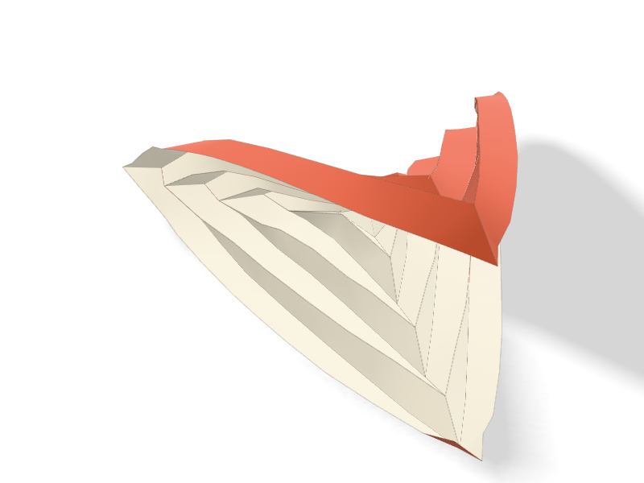

    **[Hyperbolic paraboloid](gallery/hypar.html)** · 2 steps

    Eight concentric squares, pleated alternately, and both diagonals, the Bauhaus exercise.
    No flat state holds the pleats: a settle step turns each crease toward 100°, and the paper bends.
    The sheet twists into a saddle, as it does in the hand.

    [Open in 3D](gallery/hypar.html) · [Script](https://github.com/maxencefaldor/origamy/blob/main/examples/hypar.py)

-   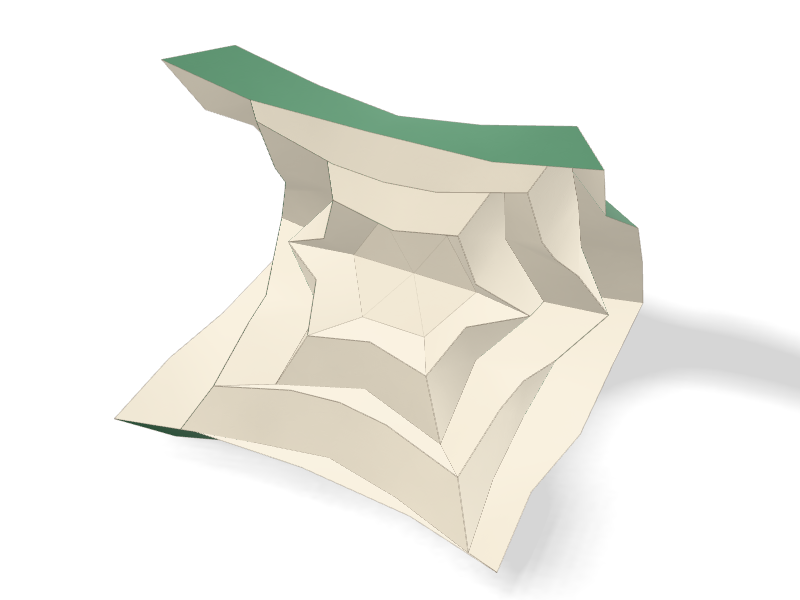

    **[Hexagonal hypar](gallery/hexagonal-hypar.html)** · 2 steps

    Six concentric hexagons, pleated alternately, and the spokes to the corners, on hexagonal paper.
    Six corners pull where a square has four, so the paper settles into a saddle with three rises and three dips.

    [Open in 3D](gallery/hexagonal-hypar.html) · [Script](https://github.com/maxencefaldor/origamy/blob/main/examples/hexagonal_hypar.py)

-   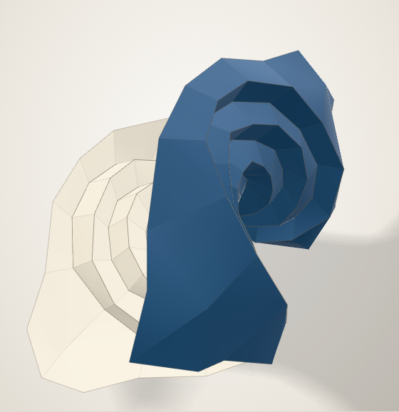

    **[Circular pleat](gallery/circular-pleat.html)** · 2 steps

    Seven concentric rings of 24 sides, pleated alternately, and radii that keep each face convex.
    A settle step turns each ring toward 110°, while the radii turn no way and the paper bends across them.
    The rings shorten as they pleat, and the paper buckles into a saddle.

    [Open in 3D](gallery/circular-pleat.html) · [Script](https://github.com/maxencefaldor/origamy/blob/main/examples/circular_pleat.py)

-   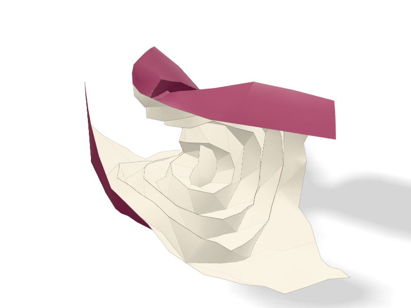

    **[Spiral pleat](gallery/spiral-pleat.html)** · 2 steps

    Seven concentric dodecagons, each turned 15° on the one inside it, pleated alternately, and the slants between their corners.
    The pleats shorten the rings and the slants twist them, so the paper settles into a spiral shell.

    [Open in 3D](gallery/spiral-pleat.html) · [Script](https://github.com/maxencefaldor/origamy/blob/main/examples/spiral_pleat.py)

-   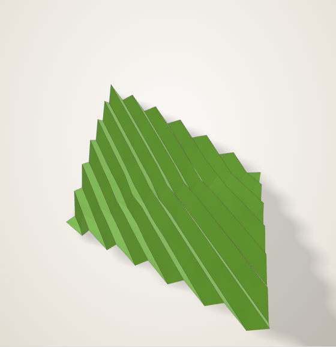

    **[Pleated leaf](gallery/leaf.html)** · 2 steps

    Pleats square to one diagonal, alternately valley and mountain, and the other diagonal as the midrib.
    A settle step turns the pleats toward 120° and the midrib toward 40°, and the leaf's halves curl.

    [Open in 3D](gallery/leaf.html) · [Script](https://github.com/maxencefaldor/origamy/blob/main/examples/leaf.py)

-   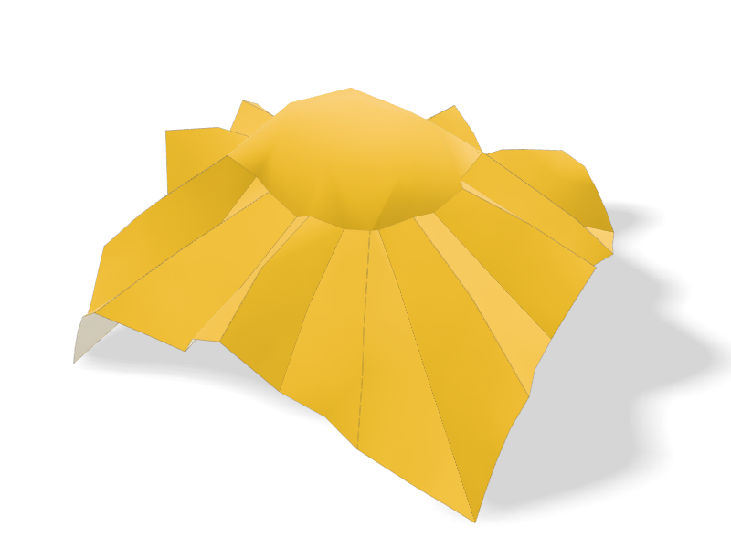

    **[Sunflower](gallery/sunflower.html)** · 2 steps

    A 24-sided disc and the pleats that radiate from its corners to the paper's edges.
    The pleats gather the paper round the disc, which domes up as the flower's heart while the petals spread.

    [Open in 3D](gallery/sunflower.html) · [Script](https://github.com/maxencefaldor/origamy/blob/main/examples/sunflower.py)

-   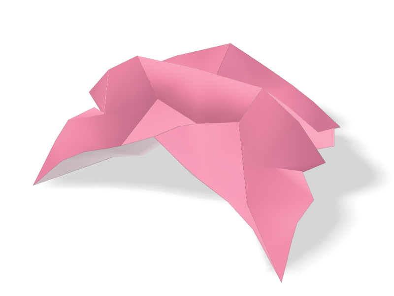

    **[Lotus](gallery/lotus.html)** · 2 steps

    An octagon and the pleats that radiate from its corners, folding toward 110°.
    The paper gathers into a cup round the octagon, and the pleats between its corners flare out as petals.

    [Open in 3D](gallery/lotus.html) · [Script](https://github.com/maxencefaldor/origamy/blob/main/examples/lotus.py)

-   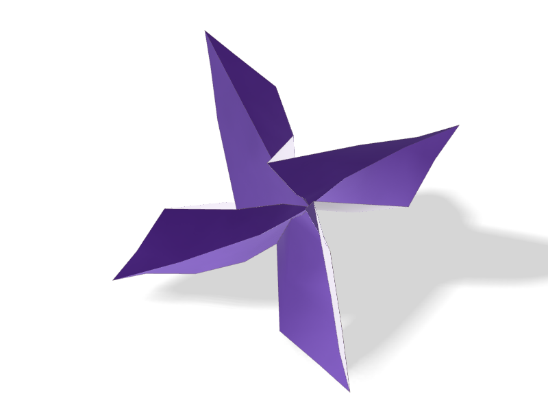

    **[Four-pointed star](gallery/star.html)** · 2 steps

    Eight rays from the center, to the corners and the middles of the edges, alternately valley and mountain.
    Four valleys gather the paper between four mountains, which rise as the star's points.

    [Open in 3D](gallery/star.html) · [Script](https://github.com/maxencefaldor/origamy/blob/main/examples/star.py)

## Geometry

Regular shapes folded from a square, as Sundara Row's *Geometric Exercises in Paper Folding* of 1893 teaches.

-   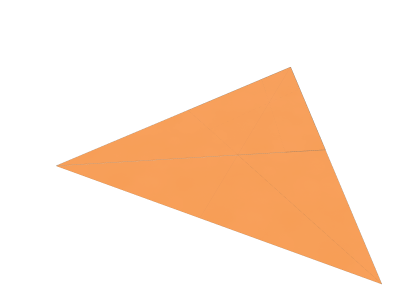

    **[Equilateral triangle](gallery/equilateral-triangle.html)** · 5 steps

    A corner folds onto the midline, the fold through the opposite corner: the apex lands at height √3/2.
    Two folds through the apex then turn the rest behind, with every angle exactly 60°.
    A third fold tucks back the top edge's middle, which the second carried past the first.

    [Open in 3D](gallery/equilateral-triangle.html) · [Script](https://github.com/maxencefaldor/origamy/blob/main/examples/equilateral_triangle.py)

-   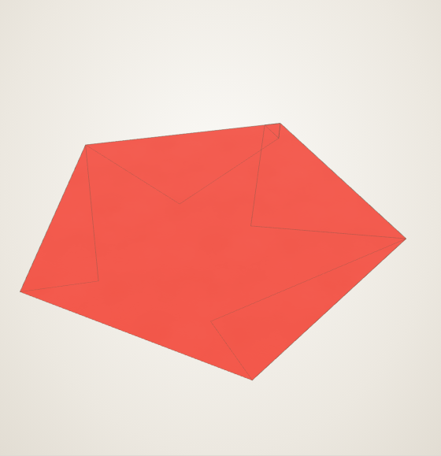

    **[Pentagon](gallery/pentagon.html)** · 4 steps

    A regular pentagon whose diagonal spans the square, its sides (√5 - 1)/2, the golden ratio's inverse.
    Its base lies on the bottom edge and its side corners on the square's sides; the rest folds behind.

    [Open in 3D](gallery/pentagon.html) · [Script](https://github.com/maxencefaldor/origamy/blob/main/examples/pentagon.py)

-   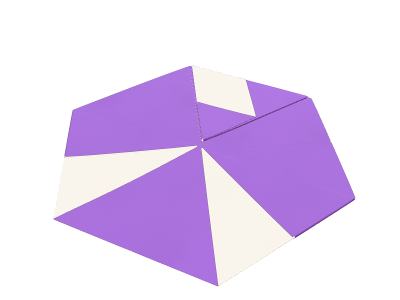

    **[Hexagon](gallery/hexagon.html)** · 8 steps

    The equilateral triangle, its corners folded to its center at height √3/6.
    Each fold cuts a third from both sides at its corner, so the hexagon is regular.

    [Open in 3D](gallery/hexagon.html) · [Script](https://github.com/maxencefaldor/origamy/blob/main/examples/hexagon.py)

-   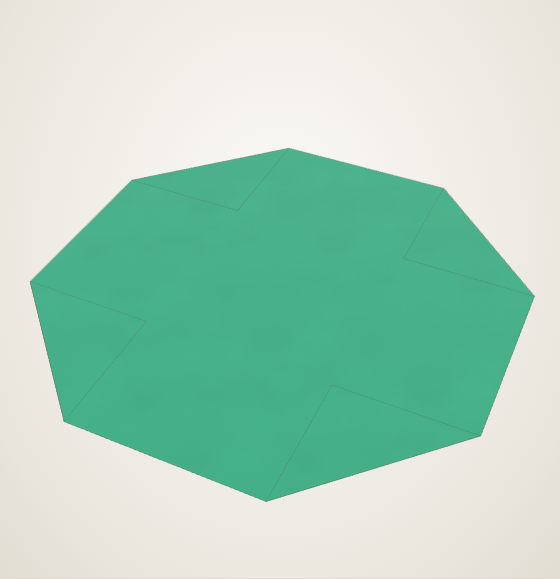

    **[Octagon](gallery/octagon.html)** · 4 steps

    Each corner folds behind along a cut of 1 - √2/2 from both its edges.
    The eight sides come out equal, at √2 - 1, so the octagon is regular.

    [Open in 3D](gallery/octagon.html) · [Script](https://github.com/maxencefaldor/origamy/blob/main/examples/octagon.py)

## Bases

The bases most traditional models start from: plain folds, collapses and petal folds.

-   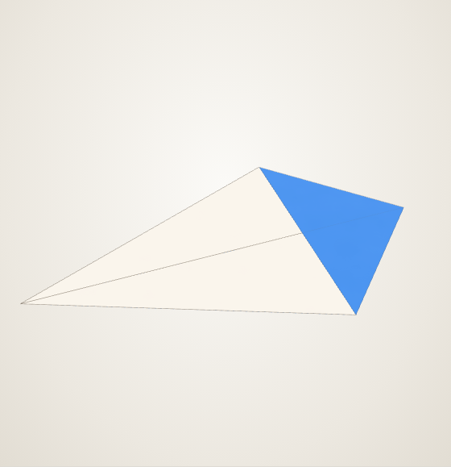

    **[Kite base](gallery/kite-base.html)** · 3 steps

    Two edges folded onto a diagonal, each fold bisecting a 45° corner.
    The kite's sharp point holds 45° of paper, and its sides turn at 22.5°.

    [Open in 3D](gallery/kite-base.html) · [Script](https://github.com/maxencefaldor/origamy/blob/main/examples/kite_base.py)

-   

    **[Blintz base](gallery/blintz-base.html)** · 4 steps

    Each corner folded to the center: a square half the paper's area, two layers thick.

    [Open in 3D](gallery/blintz-base.html) · [Script](https://github.com/maxencefaldor/origamy/blob/main/examples/blintz_base.py)

-   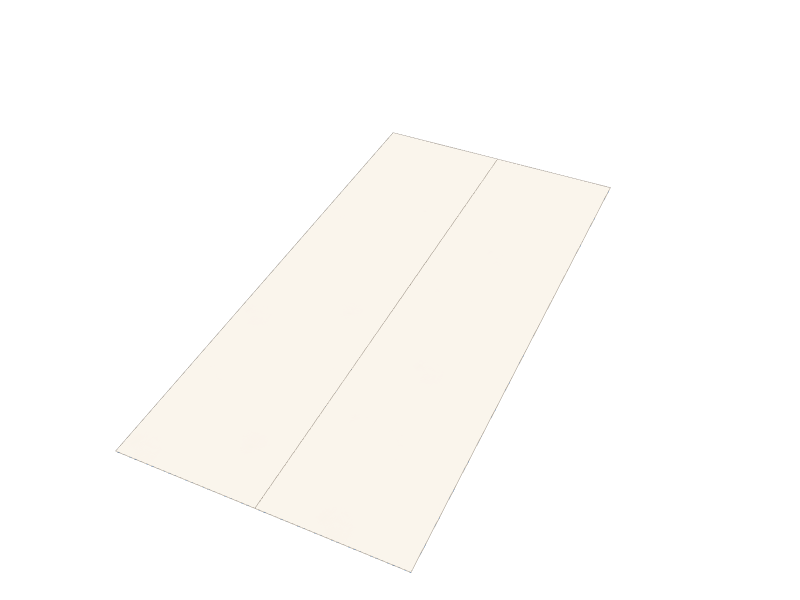

    **[Cupboard base](gallery/cupboard-base.html)** · 2 steps

    Two opposite edges folded to the middle, as a cupboard's doors.

    [Open in 3D](gallery/cupboard-base.html) · [Script](https://github.com/maxencefaldor/origamy/blob/main/examples/cupboard_base.py)

-   

    **[Waterbomb base](gallery/waterbomb-base.html)** · 4 steps

    Valley diagonals and a mountain midline, collapsed in one step into a triangle.

    [Open in 3D](gallery/waterbomb-base.html) · [Script](https://github.com/maxencefaldor/origamy/blob/main/examples/waterbomb_base.py)

## Originals

Models designed with origamy, each a short composition of the same exact actions.

-   

    **[Window](gallery/window.html)** · 10 steps

    The corners fold to the center, then each tip folds back to its flap's edge.
    The paper's two colors frame a square pane.

    [Open in 3D](gallery/window.html) · [Script](https://github.com/maxencefaldor/origamy/blob/main/examples/window.py)

-   

    **[Arrowhead](gallery/arrowhead.html)** · 11 steps

    A preliminary base whose front and back flaps fold their edges to the center, as a bird base begins, and stop there.

    [Open in 3D](gallery/arrowhead.html) · [Script](https://github.com/maxencefaldor/origamy/blob/main/examples/arrowhead.py)

