# Gallery

The models below each fold with one command from [`examples/`](https://github.com/maxencefaldor/origamy/tree/main/examples).
Each opens in the 3D viewer, to replay its steps, orbit the paper and see every layer in x-ray.
The viewer opens in its studio, lighting the paper as paper; its Studio button turns the view into a diagram.
Each viewer plays the model as origamy's simulator folds it, from the flat sheet, each step resting exactly in its state.
The viewer also traces each face back to the crease pattern.

## In space

Models that end out of the plane: shaped about their hinges, or opened as rigid origami.

-   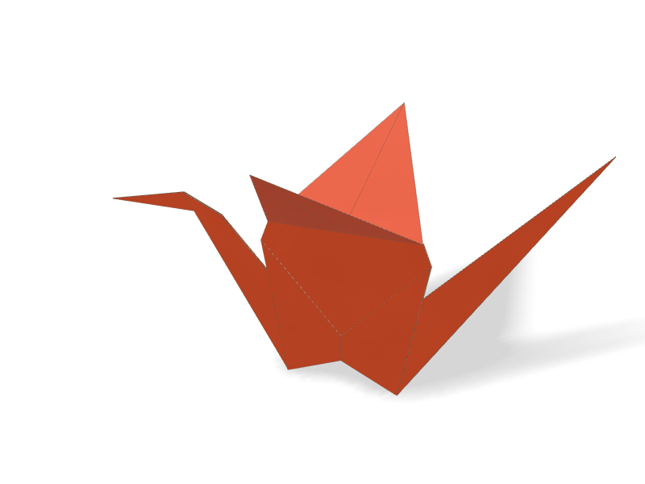

    **[Crane](gallery/crane.html)** · 33 steps

    The orizuru: a bird base, narrowed on both sides, with its neck, tail and head reverse folded up.
    Narrowing the legs bisects 22.5° angles, so its creases live at 11.25°, exactly.
    Its wings then rise 30° above level, and the crane stands up on its shoulders.

    [Open in 3D](gallery/crane.html) · [Script](https://github.com/maxencefaldor/origamy/blob/main/examples/crane.py)

-   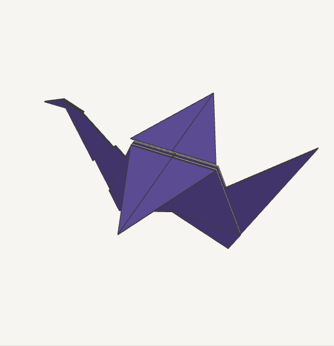

    **[Flapping bird](gallery/flapping-bird.html)** · 29 steps

    A bird base with its two lower flaps reversed up as neck and tail, and its wings folded down, then raised 30° above level.
    Two precreases mark a quarter of the neck, where the head reverse folds.

    [Open in 3D](gallery/flapping-bird.html) · [Script](https://github.com/maxencefaldor/origamy/blob/main/examples/flapping_bird.py)

-   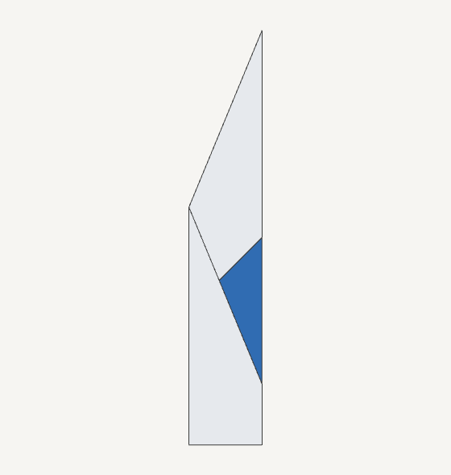

    **[Paper plane](gallery/paper-plane.html)** · 14 steps

    The classic dart, from A-series paper √2 times as tall as it is wide.
    Each wing folds square to the keel, halfway along the tail, then spreads level from the body.

    [Open in 3D](gallery/paper-plane.html) · [Script](https://github.com/maxencefaldor/origamy/blob/main/examples/paper_plane.py)

-   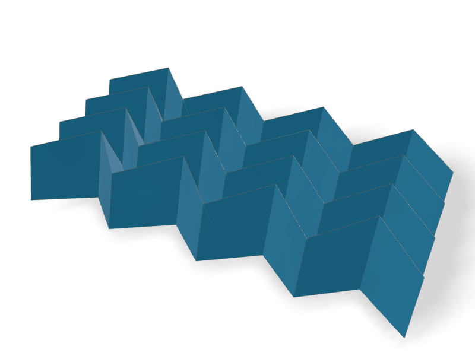

    **[Miura-ori](gallery/miura-ori.html)** · 4 steps

    A grid of parallelograms: zigzags alternate mountain and valley, and each column alternates along its length.
    Its 112 creases collapse into one flat stack, then open as rigid origami, the zigzags following the columns.
    Opened, the sheet lies down on its ridges.

    [Open in 3D](gallery/miura-ori.html) · [Script](https://github.com/maxencefaldor/origamy/blob/main/examples/miura_ori.py)

## Classics

Traditional models that end flat, folded step by step as diagrams teach them, with every crease exact.

-   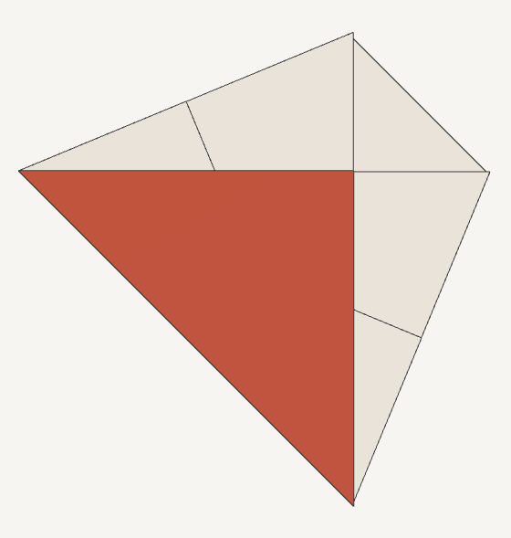

    **[Cup](gallery/cup.html)** · 9 steps

    A traditional paper cup, from simple folds only.
    Each side corner travels along its angle's bisector, found by a precrease.

    [Open in 3D](gallery/cup.html) · [Script](https://github.com/maxencefaldor/origamy/blob/main/examples/cup.py)

-   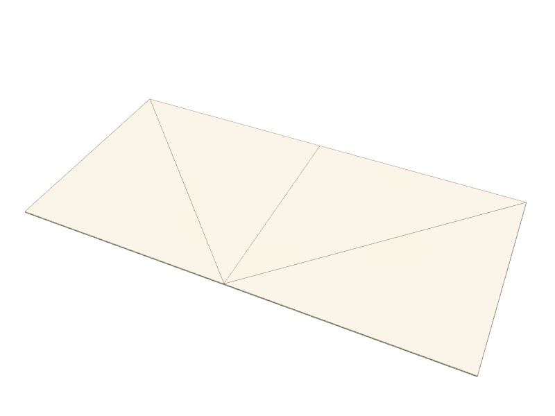

    **[Fortune teller](gallery/fortune-teller.html)** · 13 steps

    Corners to the center on both sides, then folded in half: the flat form before the fingers go in.
    The diagonals, creased first, locate every fold.

    [Open in 3D](gallery/fortune-teller.html) · [Script](https://github.com/maxencefaldor/origamy/blob/main/examples/fortune_teller.py)

-   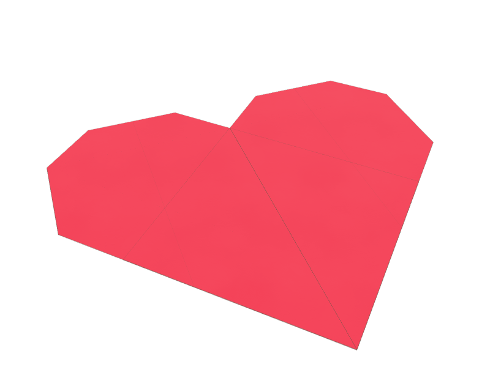

    **[Heart](gallery/heart.html)** · 10 steps

    A square on its corner: the top corner folds to the center and the bottom corner up to the top edge.
    The bottom edges fold up onto the axis as the heart's point, and the lobes' corners fold behind.

    [Open in 3D](gallery/heart.html) · [Script](https://github.com/maxencefaldor/origamy/blob/main/examples/heart.py)

-   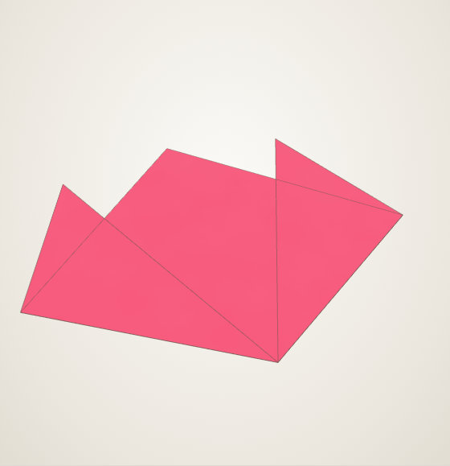

    **[Tulip](gallery/tulip.html)** · 3 steps

    A triangle whose bottom corners rise past its top as petals, each 22.5° off the flower's axis.
    Each petal's tip lies on a bisector at the base's middle, and its fold bisects the angle from its corner to that tip.

    [Open in 3D](gallery/tulip.html) · [Script](https://github.com/maxencefaldor/origamy/blob/main/examples/tulip.py)

## Bases

The bases most traditional models start from, each a collapse or a petal fold.

-   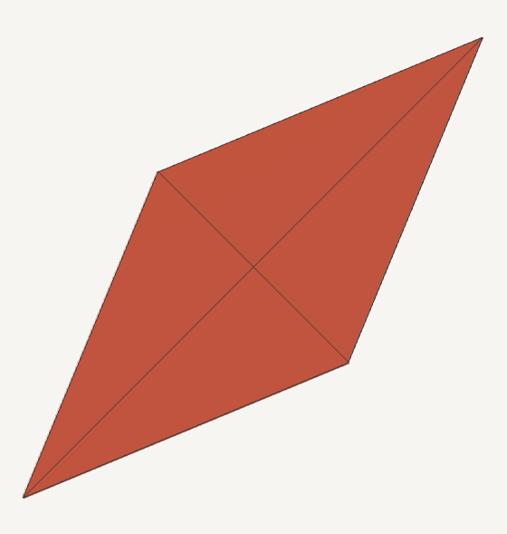

    **[Bird base](gallery/bird-base.html)** · 15 steps

    A preliminary base with a petal fold on its front and its back.
    Each petal fold lifts a layer while its sides fold in along creases made before.

    [Open in 3D](gallery/bird-base.html) · [Script](https://github.com/maxencefaldor/origamy/blob/main/examples/bird_base.py)

-   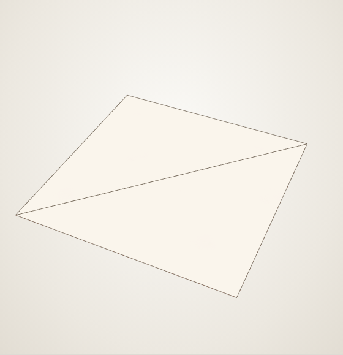

    **[Preliminary base](gallery/preliminary-base.html)** · 5 steps

    Four precreases through the center, collapsed in one step into a square of four flaps.

    [Open in 3D](gallery/preliminary-base.html) · [Script](https://github.com/maxencefaldor/origamy/blob/main/examples/preliminary_base.py)

-   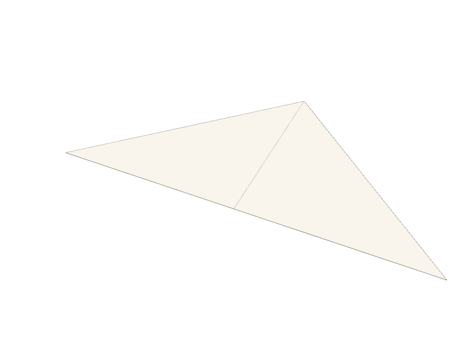

    **[Waterbomb base](gallery/waterbomb-base.html)** · 4 steps

    Valley diagonals and a mountain midline, collapsed in one step into a triangle.

    [Open in 3D](gallery/waterbomb-base.html) · [Script](https://github.com/maxencefaldor/origamy/blob/main/examples/waterbomb_base.py)

## Crease patterns

Models creased on the open paper from their crease pattern, then collapsed in one step.

-   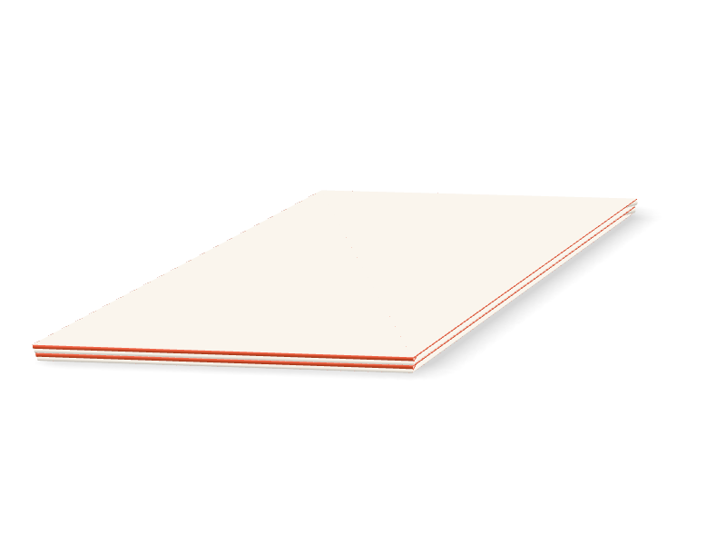

    **[Frog base](gallery/frog-base.html)** · 2 steps

    A preliminary base with all four flaps squashed and petal folded, collapsed from its pattern at once.
    Its kites fold at 22.5°, and sixteen layers meet in its thickest point.

    [Open in 3D](gallery/frog-base.html) · [Script](https://github.com/maxencefaldor/origamy/blob/main/examples/frog_base.py)

## Originals

Models designed with origamy, each a short composition of the same exact actions.

-   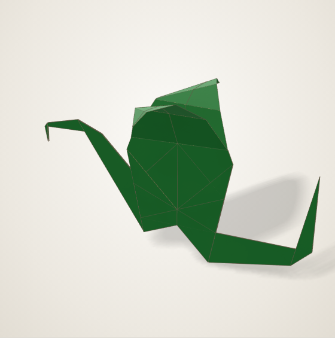

    **[Dragon](gallery/dragon.html)** · 43 steps

    A wyvern from a bird base: the legs reverse fold into a rising neck and a level tail, whose tip curls up round the outside.
    The head's snout hooks down, and each wing rises high, then arches down at three fingers that run from its wrist, as a bat's does.

    [Open in 3D](gallery/dragon.html) · [Script](https://github.com/maxencefaldor/origamy/blob/main/examples/dragon.py)

-   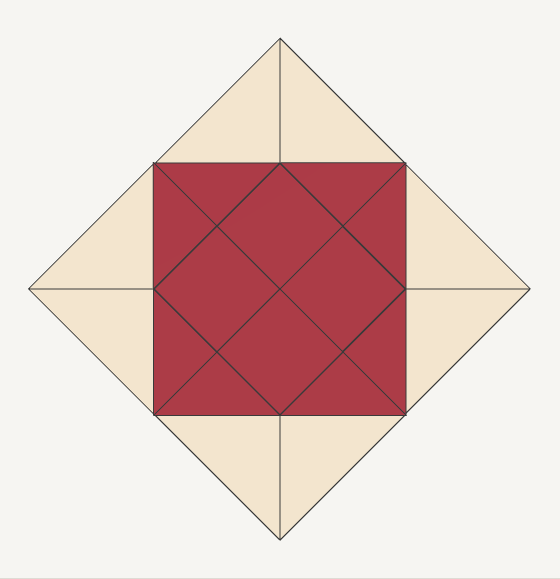

    **[Window](gallery/window.html)** · 10 steps

    The corners fold to the center, then each tip folds back to its flap's edge.
    The paper's two colors frame a square pane.

    [Open in 3D](gallery/window.html) · [Script](https://github.com/maxencefaldor/origamy/blob/main/examples/window.py)

-   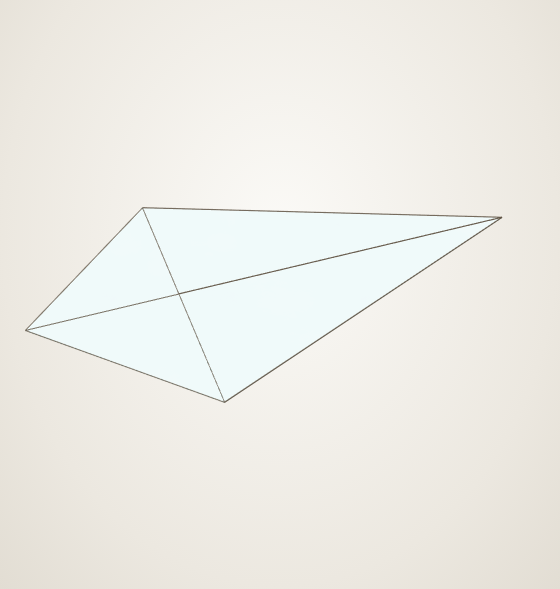

    **[Arrowhead](gallery/arrowhead.html)** · 11 steps

    A preliminary base whose front and back flaps fold their edges to the center, as a bird base begins, and stop there.

    [Open in 3D](gallery/arrowhead.html) · [Script](https://github.com/maxencefaldor/origamy/blob/main/examples/arrowhead.py)

-   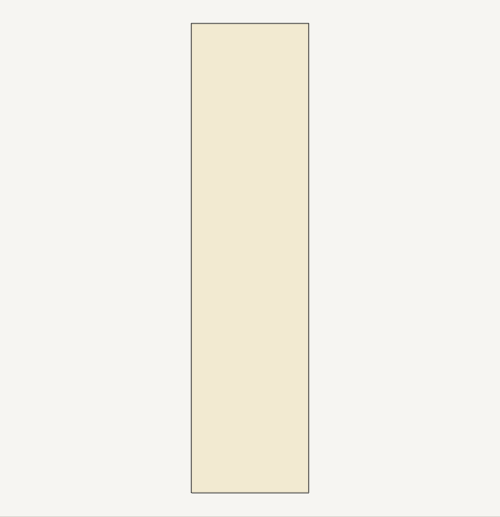

    **[Pleated fan](gallery/pleated-fan.html)** · 9 steps

    Seven precreases, found by halving, collapse at once into alternate pleats, then the stack folds in half.

    [Open in 3D](gallery/pleated-fan.html) · [Script](https://github.com/maxencefaldor/origamy/blob/main/examples/pleated_fan.py)

-   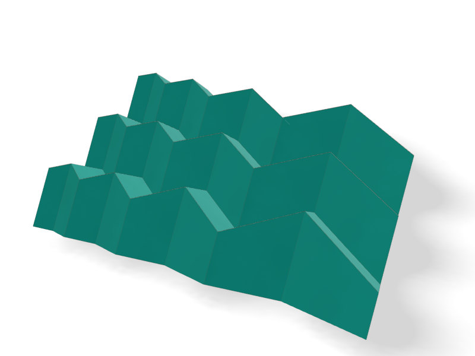

    **[Swell](gallery/swell.html)** · 4 steps

    A Miura-ori whose columns each grow a quarter wider than the last, their zigzags growing with them.
    Every zigzag keeps one slope, so every vertex keeps the Miura-ori's angles and the paper still opens rigidly, swelling as it goes.

    [Open in 3D](gallery/swell.html) · [Script](https://github.com/maxencefaldor/origamy/blob/main/examples/swell.py)

-   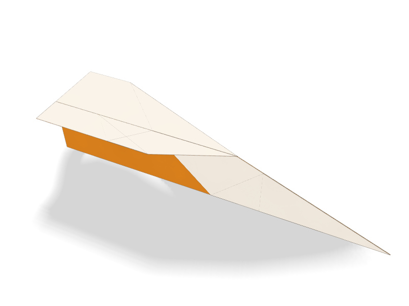

    **[Winglet dart](gallery/winglet-dart.html)** · 16 steps

    The classic dart, each wingtip turned up square as a winglet.
    Each winglet's crease lies where the paper's edge folds onto the wing's crease.

    [Open in 3D](gallery/winglet-dart.html) · [Script](https://github.com/maxencefaldor/origamy/blob/main/examples/winglet_dart.py)

