# Gallery

The models below each fold with one command from [`examples/`](https://github.com/maxencefaldor/origamy/tree/main/examples).
Each opens in the 3D viewer, to replay its steps, orbit the paper and see every layer in x-ray.
The viewer opens in its studio, lighting the paper as paper; its Studio button turns the view into a diagram.
Each viewer plays the model as origamy's simulator folds it, from the flat sheet, each step resting exactly in its state.
The viewer also traces each face back to the crease pattern.

## Birds and insects

Models with wings, shaped out of the plane to stand or spread.

-   

    **[Crane](gallery/crane.html)** · 33 steps

    The orizuru: a bird base, narrowed on both sides, with its neck, tail and head reverse folded up.
    Narrowing the legs bisects 22.5° angles, so its creases live at 11.25°, exactly.
    Its wings then rise 30° above level, and the crane stands up on its shoulders.

    [Open in 3D](gallery/crane.html) · [Script](https://github.com/maxencefaldor/origamy/blob/main/examples/crane.py)

-   

    **[Flapping bird](gallery/flapping-bird.html)** · 30 steps

    A bird base with its two lower flaps reversed up as neck and tail, and its wings folded down, then raised 30° above level.
    Two precreases mark a quarter of the neck, where the head reverse folds.
    A settle step then eases every fold 15° open, and the paper puffs up.

    [Open in 3D](gallery/flapping-bird.html) · [Script](https://github.com/maxencefaldor/origamy/blob/main/examples/flapping_bird.py)

-   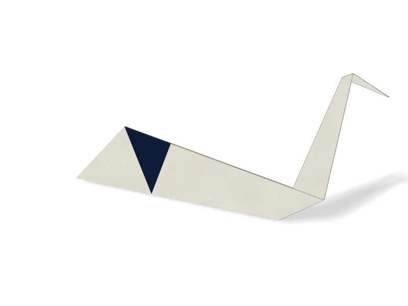

    **[Swan](gallery/swan.html)** · 11 steps

    A kite turned over and folded narrower, then halved along its spine.
    The point reverses up as the neck, and its tip reverses forward as the head.
    The swan stands on its belly, the kite's middle showing at its tail.
    A settle step then eases every fold 15° open, and the paper puffs up.

    [Open in 3D](gallery/swan.html) · [Script](https://github.com/maxencefaldor/origamy/blob/main/examples/swan.py)

-   

    **[Penguin](gallery/penguin.html)** · 8 steps

    A kite, its white side up, whose sides stop short of the spine, so a white belly shows between black wings.
    The feet fold up and the head down, both black, and the penguin stands on its feet.
    A settle step then eases every fold 15° open, and the paper puffs up.

    [Open in 3D](gallery/penguin.html) · [Script](https://github.com/maxencefaldor/origamy/blob/main/examples/penguin.py)

-   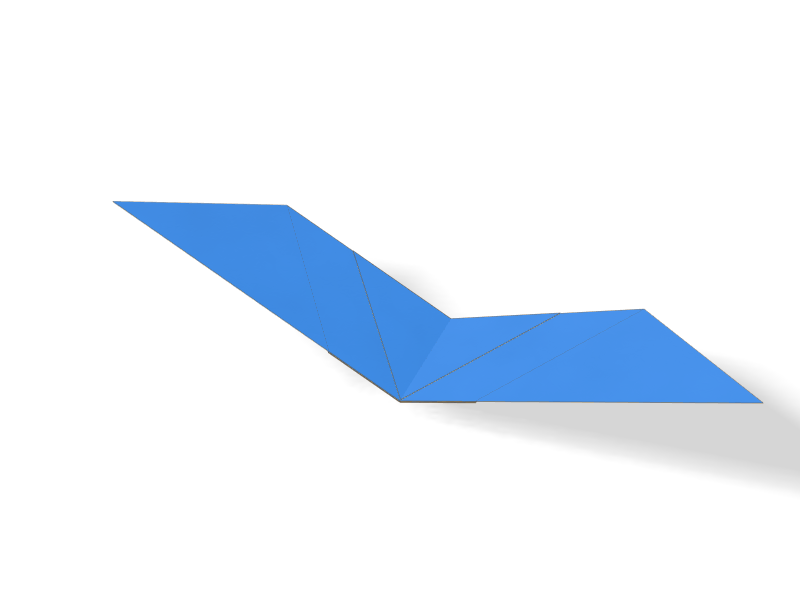

    **[Butterfly](gallery/butterfly.html)** · 12 steps

    A waterbomb base whose front flaps fold up into a diamond.
    Its apex folds down past the base, and its tip folds back over the edge as a lock.
    The wings then rise in a V, 25° each side of the body.

    [Open in 3D](gallery/butterfly.html) · [Script](https://github.com/maxencefaldor/origamy/blob/main/examples/butterfly.py)

-   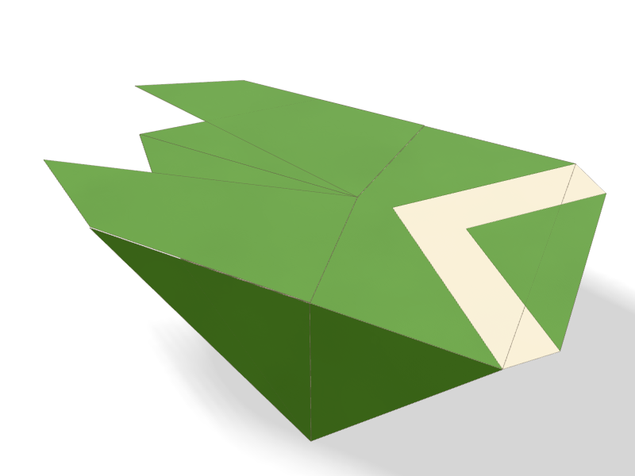

    **[Cicada](gallery/cicada.html)** · 10 steps

    The semi: a triangle whose corners fold up to its tip, then down past its tail as wings.
    Each wing's fold runs through its flap's corner, so the wings part at the tail.
    Two folds of the head show the paper's back as stripes, and the body's sides turn down 75°.
    A settle step then eases every fold 15° open, and the paper puffs up.

    [Open in 3D](gallery/cicada.html) · [Script](https://github.com/maxencefaldor/origamy/blob/main/examples/cicada.py)

## Animals and faces

Heads and bodies folded flat, then stood up or lifted into relief.

-   

    **[Whale](gallery/whale.html)** · 9 steps

    A kite whose blunt corner folds over as the head, halved along its spine.
    The tail reverse folds up between the body's layers, and the whale stands on its belly.
    A settle step then eases every fold 15° open, and the paper puffs up.

    [Open in 3D](gallery/whale.html) · [Script](https://github.com/maxencefaldor/origamy/blob/main/examples/whale.py)

-   

    **[Fox face](gallery/fox-face.html)** · 9 steps

    A triangle whose corners fold down to the chin, then back up past the head as ears.
    Each ear's fold runs from the bottom edge to the spine, never across the flap's hinge.
    The ears lean 25° forward, and the face stands on its chin.
    A settle step then eases every fold 15° open, and the paper puffs up.

    [Open in 3D](gallery/fox-face.html) · [Script](https://github.com/maxencefaldor/origamy/blob/main/examples/fox_face.py)

-   

    **[Dog face](gallery/dog-face.html)** · 8 steps

    A triangle whose corners fold down as ears, the chin's tip turned up as the nose.
    The ears lift 35° off the face, and the face stands on its chin.
    A settle step then eases every fold 15° open, and the paper puffs up.

    [Open in 3D](gallery/dog-face.html) · [Script](https://github.com/maxencefaldor/origamy/blob/main/examples/dog_face.py)

-   

    **[Cat face](gallery/cat-face.html)** · 10 steps

    A triangle whose corners fold up past its top as ears, square to the head's axis.
    Each ear turns about its side's middle, and the chin's tip tucks behind.
    The ears lean 30° forward, and the face stands on its chin.
    A settle step then eases every fold 15° open, and the paper puffs up.

    [Open in 3D](gallery/cat-face.html) · [Script](https://github.com/maxencefaldor/origamy/blob/main/examples/cat_face.py)

-   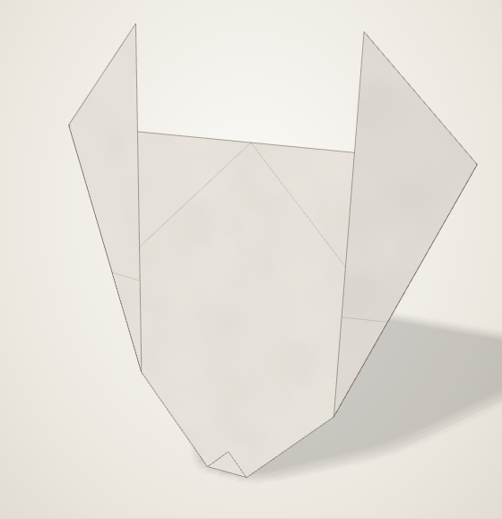

    **[Rabbit face](gallery/rabbit-face.html)** · 10 steps

    The cat face's triangle, its ears turned about points near the chin, so they rise far past the head.
    The ears lean 15° forward, and the face stands on its chin.
    A settle step then eases every fold 15° open, and the paper puffs up.

    [Open in 3D](gallery/rabbit-face.html) · [Script](https://github.com/maxencefaldor/origamy/blob/main/examples/rabbit_face.py)

-   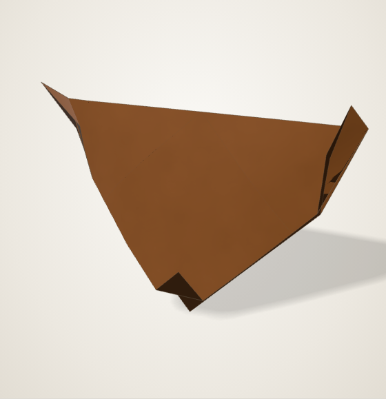

    **[Bear face](gallery/bear-face.html)** · 10 steps

    The cat face's triangle, its ears turned about points near the corners, so they just peek past the head.
    The chin's tip turns up on the front layer as the snout, and the face stands on it.
    A settle step then eases every fold 15° open, and the paper puffs up.

    [Open in 3D](gallery/bear-face.html) · [Script](https://github.com/maxencefaldor/origamy/blob/main/examples/bear_face.py)

## Things

Traditional toys and objects, each ending in space.

-   

    **[Samurai helmet](gallery/samurai-helmet.html)** · 11 steps

    The kabuto: a triangle whose corners fold down, then up and out as horns.
    The brim rolls up twice over the horns' roots, and the helmet stands on it.

    [Open in 3D](gallery/samurai-helmet.html) · [Script](https://github.com/maxencefaldor/origamy/blob/main/examples/samurai_helmet.py)

-   

    **[Newspaper hat](gallery/newspaper-hat.html)** · 9 steps

    A sheet twice as tall as wide, halved, its top corners folded down to the middle.
    Each brim rolls up twice, the front over the corners and the back behind them.
    A settle step then eases every fold 15° open, and the paper puffs up.

    [Open in 3D](gallery/newspaper-hat.html) · [Script](https://github.com/maxencefaldor/origamy/blob/main/examples/newspaper_hat.py)

-   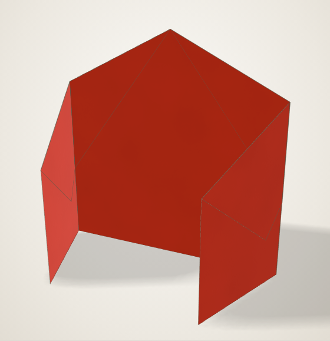

    **[House](gallery/house.html)** · 8 steps

    A sheet halved, its roof's corners folded behind, its sides folded in as doors.
    The doors open 70°, and the house stands up on its floor.

    [Open in 3D](gallery/house.html) · [Script](https://github.com/maxencefaldor/origamy/blob/main/examples/house.py)

-   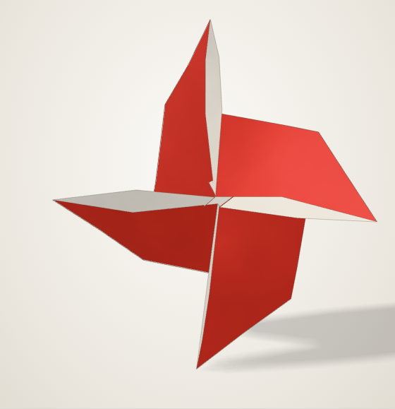

    **[Pinwheel](gallery/pinwheel.html)** · 4 steps

    The middle square's sides, the corners' diagonals and four slants, collapsed in one step.
    The pattern turns onto itself a quarter turn, so the four vanes chase each other.
    A settle step then eases every fold 35° open, and the vanes lift.

    [Open in 3D](gallery/pinwheel.html) · [Script](https://github.com/maxencefaldor/origamy/blob/main/examples/pinwheel.py)

-   

    **[Envelope](gallery/envelope.html)** · 5 steps

    A square on its corner: its side corners fold to the center, and its bottom corner folds up past it.
    The top corner folds down over them as the flap, and a settle step eases the folds 10° open.

    [Open in 3D](gallery/envelope.html) · [Script](https://github.com/maxencefaldor/origamy/blob/main/examples/envelope.py)

## Planes

Paper planes whose wings spread level from the body.

-   

    **[Paper plane](gallery/paper-plane.html)** · 15 steps

    The classic dart, from A-series paper √2 times as tall as it is wide.
    Each wing folds square to the keel, halfway along the tail, then spreads level from the body.
    A settle step then eases every fold 15° open, and the paper puffs up.

    [Open in 3D](gallery/paper-plane.html) · [Script](https://github.com/maxencefaldor/origamy/blob/main/examples/paper_plane.py)

-   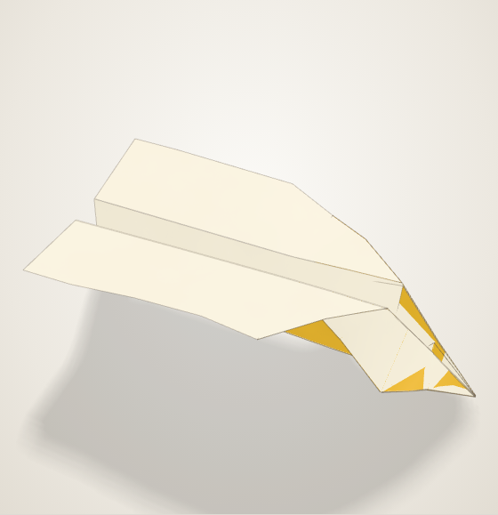

    **[Glider](gallery/glider.html)** · 16 steps

    A paper plane whose nose folds back onto the corners' feet, so its wings run wide.
    The new corners fold to the keel again, and the wings spread level from the body.
    A settle step then eases every fold 20° open, and the paper puffs up.

    [Open in 3D](gallery/glider.html) · [Script](https://github.com/maxencefaldor/origamy/blob/main/examples/glider.py)

-   

    **[Nakamura lock](gallery/nakamura-lock.html)** · 9 steps

    A paper plane whose nose folds down, then whose corners fold to the keel above the nose's tip.
    The tip folds up over the corners and locks them.
    The wings stay open, raised in a shallow V about the keel.

    [Open in 3D](gallery/nakamura-lock.html) · [Script](https://github.com/maxencefaldor/origamy/blob/main/examples/nakamura_lock.py)

## Classics

Traditional models folded step by step as diagrams teach them, with every crease exact.

-   

    **[Tulip](gallery/tulip.html)** · 4 steps

    A triangle whose bottom corners rise past its top as petals, each 22.5° off the flower's axis.
    Each petal's tip lies on a bisector at the base's middle, and its fold bisects the angle from its corner to that tip.
    A settle step opens the flower: the petals spread and the cup rounds as the paper bends.

    [Open in 3D](gallery/tulip.html) · [Script](https://github.com/maxencefaldor/origamy/blob/main/examples/tulip.py)

-   

    **[Heart](gallery/heart.html)** · 11 steps

    A square on its corner: the top corner folds to the center and the bottom corner up to the top edge.
    The bottom edges fold up onto the axis as the heart's point, and the lobes' corners fold behind.
    A settle step eases every fold 15° open, and the heart puffs up as pressed paper does.

    [Open in 3D](gallery/heart.html) · [Script](https://github.com/maxencefaldor/origamy/blob/main/examples/heart.py)

-   

    **[Cup](gallery/cup.html)** · 9 steps

    A traditional paper cup, from simple folds only.
    Each side corner travels along its angle's bisector, found by a precrease.

    [Open in 3D](gallery/cup.html) · [Script](https://github.com/maxencefaldor/origamy/blob/main/examples/cup.py)

-   

    **[Fortune teller](gallery/fortune-teller.html)** · 13 steps

    Corners to the center on both sides, then folded in half: the flat form before the fingers go in.
    The diagonals, creased first, locate every fold.

    [Open in 3D](gallery/fortune-teller.html) · [Script](https://github.com/maxencefaldor/origamy/blob/main/examples/fortune_teller.py)

-   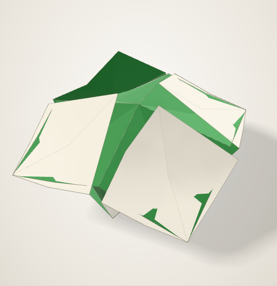

    **[Salt cellar](gallery/salt-cellar.html)** · 15 steps

    The fortune teller before its last fold, with both middle lines creased.
    Murray and Rigney's *Fun with Paper Folding* of 1928 calls this form the salt cellar.
    A settle step turns the middle lines toward 100° as mountains and eases every other fold 40°, and the four pockets rise.

    [Open in 3D](gallery/salt-cellar.html) · [Script](https://github.com/maxencefaldor/origamy/blob/main/examples/salt_cellar.py)

## Settled forms

Crease patterns that no flat state holds: a settle step turns their creases, and the simulator lets the paper bend into a curved form.

-   

    **[Hyperbolic paraboloid](gallery/hypar.html)** · 2 steps

    Eight concentric squares, pleated alternately, and both diagonals, the Bauhaus exercise.
    No flat state holds the pleats: a settle step turns each crease toward 100°, and the paper bends.
    The sheet twists into a saddle, as it does in the hand.

    [Open in 3D](gallery/hypar.html) · [Script](https://github.com/maxencefaldor/origamy/blob/main/examples/hypar.py)

-   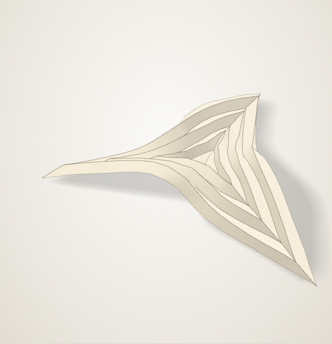

    **[Triangular hypar](gallery/triangular-hypar.html)** · 2 steps

    Seven concentric triangles, pleated alternately, and the spokes to the corners, on equilateral paper.
    Three corners pull where a square has four, and the paper curls them into a twisted star.

    [Open in 3D](gallery/triangular-hypar.html) · [Script](https://github.com/maxencefaldor/origamy/blob/main/examples/triangular_hypar.py)

-   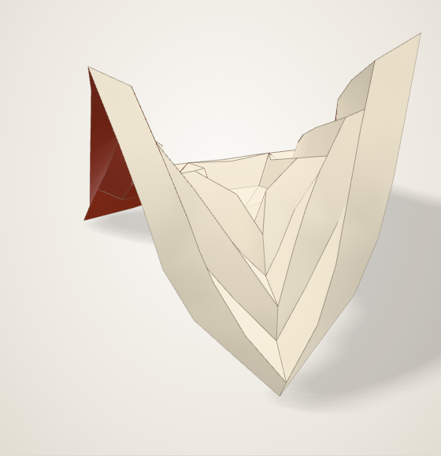

    **[Pentagonal hypar](gallery/pentagonal-hypar.html)** · 2 steps

    Seven concentric pentagons, pleated alternately, and the spokes to the corners, on pentagonal paper.
    Five corners pull, and the paper settles into a crown of rises and dips.

    [Open in 3D](gallery/pentagonal-hypar.html) · [Script](https://github.com/maxencefaldor/origamy/blob/main/examples/pentagonal_hypar.py)

-   

    **[Hexagonal hypar](gallery/hexagonal-hypar.html)** · 2 steps

    Six concentric hexagons, pleated alternately, and the spokes to the corners, on hexagonal paper.
    Six corners pull where a square has four, so the paper settles into a saddle with three rises and three dips.

    [Open in 3D](gallery/hexagonal-hypar.html) · [Script](https://github.com/maxencefaldor/origamy/blob/main/examples/hexagonal_hypar.py)

-   

    **[Circular pleat](gallery/circular-pleat.html)** · 2 steps

    Seven concentric rings of 24 sides, pleated alternately, and radii that keep each face convex.
    A settle step turns each ring toward 110°, while the radii turn no way and the paper bends across them.
    The rings shorten as they pleat, and the paper buckles into a saddle.

    [Open in 3D](gallery/circular-pleat.html) · [Script](https://github.com/maxencefaldor/origamy/blob/main/examples/circular_pleat.py)

-   

    **[Spiral pleat](gallery/spiral-pleat.html)** · 2 steps

    Seven concentric dodecagons, each turned 15° on the one inside it, pleated alternately, and the slants between their corners.
    The pleats shorten the rings and the slants twist them, so the paper settles into a spiral shell.

    [Open in 3D](gallery/spiral-pleat.html) · [Script](https://github.com/maxencefaldor/origamy/blob/main/examples/spiral_pleat.py)

-   

    **[Pleated leaf](gallery/leaf.html)** · 2 steps

    Pleats square to one diagonal, alternately valley and mountain, and the other diagonal as the midrib.
    A settle step turns the pleats toward 120° and the midrib toward 40°, and the leaf's halves curl.

    [Open in 3D](gallery/leaf.html) · [Script](https://github.com/maxencefaldor/origamy/blob/main/examples/leaf.py)

-   

    **[Sunflower](gallery/sunflower.html)** · 2 steps

    A 24-sided disc and the pleats that radiate from its corners to the paper's edges.
    The pleats gather the paper round the disc, which domes up as the flower's heart while the petals spread.

    [Open in 3D](gallery/sunflower.html) · [Script](https://github.com/maxencefaldor/origamy/blob/main/examples/sunflower.py)

-   

    **[Lotus](gallery/lotus.html)** · 2 steps

    An octagon and the pleats that radiate from its corners, folding toward 110°.
    The paper gathers into a cup round the octagon, and the pleats between its corners flare out as petals.

    [Open in 3D](gallery/lotus.html) · [Script](https://github.com/maxencefaldor/origamy/blob/main/examples/lotus.py)

-   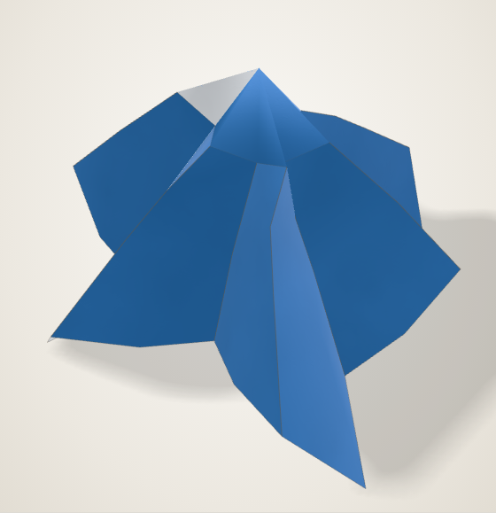

    **[Bell](gallery/bell.html)** · 2 steps

    A dodecagon and the pleats that radiate from its corners, folding toward 120°.
    The dodecagon rises as the bell's crown, and the pleated paper falls round it.

    [Open in 3D](gallery/bell.html) · [Script](https://github.com/maxencefaldor/origamy/blob/main/examples/bell.py)

-   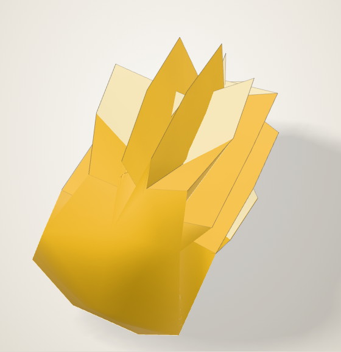

    **[Crown](gallery/crown.html)** · 2 steps

    The sunflower's crease pattern, its pleats folding far, toward 150°.
    They gather the paper into a band round the floor, and the paper's corners rise from it as points.

    [Open in 3D](gallery/crown.html) · [Script](https://github.com/maxencefaldor/origamy/blob/main/examples/crown.py)

-   

    **[Four-pointed star](gallery/star.html)** · 2 steps

    Eight rays from the center, to the corners and the middles of the edges, alternately valley and mountain.
    Four valleys gather the paper between four mountains, which rise as the star's points.

    [Open in 3D](gallery/star.html) · [Script](https://github.com/maxencefaldor/origamy/blob/main/examples/star.py)

-   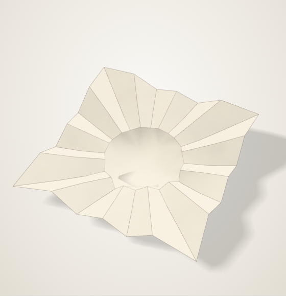

    **[Fluted dish](gallery/fluted-dish.html)** · 2 steps

    A 24-sided floor whose edge turns as a mountain, so it sinks, ringed by pleats that fold toward 60°.
    The pleats flute the paper round the floor, as a baking cup's.

    [Open in 3D](gallery/fluted-dish.html) · [Script](https://github.com/maxencefaldor/origamy/blob/main/examples/fluted_dish.py)

-   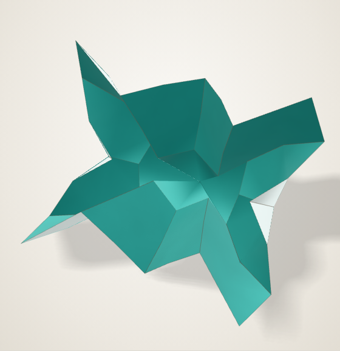

    **[Star bowl](gallery/star-bowl.html)** · 2 steps

    A dodecagon sunk in pleats that fold toward 100°.
    The pleats gather the paper into walls round the floor, and the paper's corners stand out as points.

    [Open in 3D](gallery/star-bowl.html) · [Script](https://github.com/maxencefaldor/origamy/blob/main/examples/star_bowl.py)

-   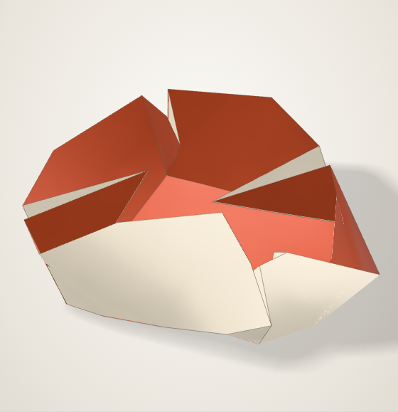

    **[Tray](gallery/tray.html)** · 2 steps

    A square floor whose edges, carried on to the paper's edges, turn up as walls.
    Each corner square folds in half along its diagonal, and the corner pinches into a fin.

    [Open in 3D](gallery/tray.html) · [Script](https://github.com/maxencefaldor/origamy/blob/main/examples/tray.py)

## Tessellations

Patterns of repeated creases, collapsed at once and opened as rigid origami.

-   

    **[Miura-ori](gallery/miura-ori.html)** · 4 steps

    A grid of parallelograms: zigzags alternate mountain and valley, and each column alternates along its length.
    Its 112 creases collapse into one flat stack, then open as rigid origami, the zigzags following the columns.
    Opened, the sheet lies down on its ridges.

    [Open in 3D](gallery/miura-ori.html) · [Script](https://github.com/maxencefaldor/origamy/blob/main/examples/miura_ori.py)

## Geometry

Regular shapes folded from a square, as Sundara Row's *Geometric Exercises in Paper Folding* of 1893 teaches.

-   

    **[Equilateral triangle](gallery/equilateral-triangle.html)** · 5 steps

    A corner folds onto the midline, the fold through the opposite corner: the apex lands at height √3/2.
    Two folds through the apex then turn the rest behind, with every angle exactly 60°.
    A third fold tucks back the top edge's middle, which the second carried past the first.

    [Open in 3D](gallery/equilateral-triangle.html) · [Script](https://github.com/maxencefaldor/origamy/blob/main/examples/equilateral_triangle.py)

-   

    **[Pentagon](gallery/pentagon.html)** · 4 steps

    A regular pentagon whose diagonal spans the square, its sides (√5 - 1)/2, the golden ratio's inverse.
    Its base lies on the bottom edge and its side corners on the square's sides; the rest folds behind.

    [Open in 3D](gallery/pentagon.html) · [Script](https://github.com/maxencefaldor/origamy/blob/main/examples/pentagon.py)

-   

    **[Hexagon](gallery/hexagon.html)** · 9 steps

    The equilateral triangle, its corners folded to its center at height √3/6.
    Each fold cuts a third from both sides at its corner, so the hexagon is regular.
    A settle step then eases every fold 20° open, and the paper puffs up.

    [Open in 3D](gallery/hexagon.html) · [Script](https://github.com/maxencefaldor/origamy/blob/main/examples/hexagon.py)

-   

    **[Octagon](gallery/octagon.html)** · 4 steps

    Each corner folds behind along a cut of 1 - √2/2 from both its edges.
    The eight sides come out equal, at √2 - 1, so the octagon is regular.

    [Open in 3D](gallery/octagon.html) · [Script](https://github.com/maxencefaldor/origamy/blob/main/examples/octagon.py)

-   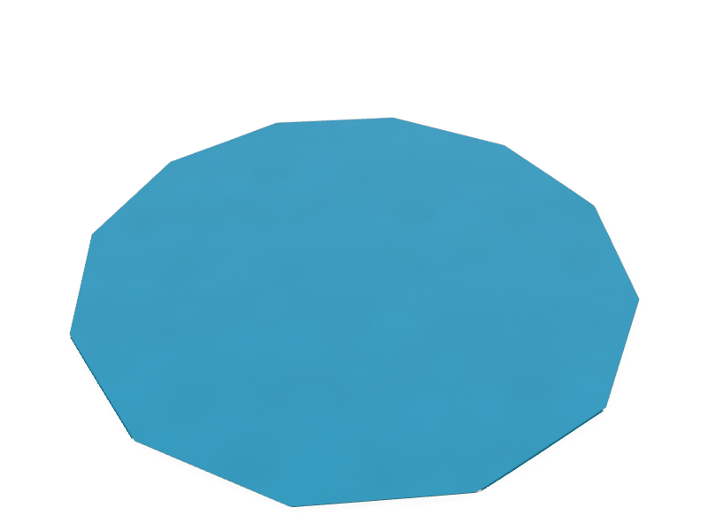

    **[Dodecagon](gallery/dodecagon.html)** · 8 steps

    A regular dodecagon whose incircle touches the square's edges, four of its sides on them.
    Two slanted sides cut each corner of the square, at 30° and 60°, and fold behind.

    [Open in 3D](gallery/dodecagon.html) · [Script](https://github.com/maxencefaldor/origamy/blob/main/examples/dodecagon.py)

## Bases

The bases most traditional models start from: plain folds, collapses and petal folds.

-   

    **[Kite base](gallery/kite-base.html)** · 4 steps

    Two edges folded onto a diagonal, each fold bisecting a 45° corner.
    The kite's sharp point holds 45° of paper, and its sides turn at 22.5°.
    A settle step then eases every fold 20° open, and the paper puffs up.

    [Open in 3D](gallery/kite-base.html) · [Script](https://github.com/maxencefaldor/origamy/blob/main/examples/kite_base.py)

-   

    **[Blintz base](gallery/blintz-base.html)** · 5 steps

    Each corner folded to the center: a square half the paper's area, two layers thick.
    A settle step then eases every fold 20° open, and the paper puffs up.

    [Open in 3D](gallery/blintz-base.html) · [Script](https://github.com/maxencefaldor/origamy/blob/main/examples/blintz_base.py)

-   

    **[Cupboard base](gallery/cupboard-base.html)** · 3 steps

    Two opposite edges folded to the middle, as a cupboard's doors.
    A settle step then eases every fold 20° open, and the paper puffs up.

    [Open in 3D](gallery/cupboard-base.html) · [Script](https://github.com/maxencefaldor/origamy/blob/main/examples/cupboard_base.py)

-   

    **[Preliminary base](gallery/preliminary-base.html)** · 6 steps

    Four precreases through the center, collapsed in one step into a square of four flaps.
    A settle step then eases every fold 20° open, and the paper puffs up.

    [Open in 3D](gallery/preliminary-base.html) · [Script](https://github.com/maxencefaldor/origamy/blob/main/examples/preliminary_base.py)

-   

    **[Waterbomb base](gallery/waterbomb-base.html)** · 5 steps

    Valley diagonals and a mountain midline, collapsed in one step into a triangle.
    A settle step then eases every fold 20° open, and the paper puffs up.

    [Open in 3D](gallery/waterbomb-base.html) · [Script](https://github.com/maxencefaldor/origamy/blob/main/examples/waterbomb_base.py)

-   

    **[Bird base](gallery/bird-base.html)** · 15 steps

    A preliminary base with a petal fold on its front and its back.
    Each petal fold lifts a layer while its sides fold in along creases made before.

    [Open in 3D](gallery/bird-base.html) · [Script](https://github.com/maxencefaldor/origamy/blob/main/examples/bird_base.py)

## Crease patterns

Models creased on the open paper from their crease pattern, then collapsed in one step.

-   

    **[Frog base](gallery/frog-base.html)** · 2 steps

    A preliminary base with all four flaps squashed and petal folded, collapsed from its pattern at once.
    Its kites fold at 22.5°, and sixteen layers meet in its thickest point.

    [Open in 3D](gallery/frog-base.html) · [Script](https://github.com/maxencefaldor/origamy/blob/main/examples/frog_base.py)

## Originals

Models designed with origamy, each a short composition of the same exact actions.

-   

    **[Window](gallery/window.html)** · 11 steps

    The corners fold to the center, then each tip folds back to its flap's edge.
    The paper's two colors frame a square pane.
    A settle step then eases every fold 20° open, and the paper puffs up.

    [Open in 3D](gallery/window.html) · [Script](https://github.com/maxencefaldor/origamy/blob/main/examples/window.py)

-   

    **[Arrowhead](gallery/arrowhead.html)** · 12 steps

    A preliminary base whose front and back flaps fold their edges to the center, as a bird base begins, and stop there.
    A settle step then eases every fold 20° open, and the paper puffs up.

    [Open in 3D](gallery/arrowhead.html) · [Script](https://github.com/maxencefaldor/origamy/blob/main/examples/arrowhead.py)

-   

    **[Pleated fan](gallery/pleated-fan.html)** · 10 steps

    Seven precreases, found by halving, collapse at once into alternate pleats, then the stack folds in half.
    Last, the pleats open while the stack stays folded, so the paper bends: the simulator settles it into a hand fan.

    [Open in 3D](gallery/pleated-fan.html) · [Script](https://github.com/maxencefaldor/origamy/blob/main/examples/pleated_fan.py)

-   

    **[Swell](gallery/swell.html)** · 4 steps

    A Miura-ori whose columns each grow a quarter wider than the last, their zigzags growing with them.
    Every zigzag keeps one slope, so every vertex keeps the Miura-ori's angles and the paper still opens rigidly, swelling as it goes.

    [Open in 3D](gallery/swell.html) · [Script](https://github.com/maxencefaldor/origamy/blob/main/examples/swell.py)

-   

    **[Winglet dart](gallery/winglet-dart.html)** · 17 steps

    The classic dart, each wingtip turned up square as a winglet.
    Each winglet's crease lies where the paper's edge folds onto the wing's crease.
    A settle step then eases every fold 20° open, and the paper puffs up.

    [Open in 3D](gallery/winglet-dart.html) · [Script](https://github.com/maxencefaldor/origamy/blob/main/examples/winglet_dart.py)

