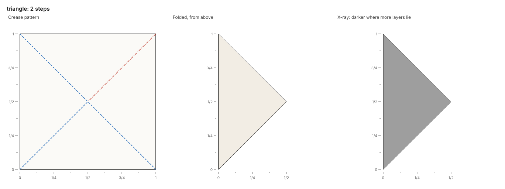
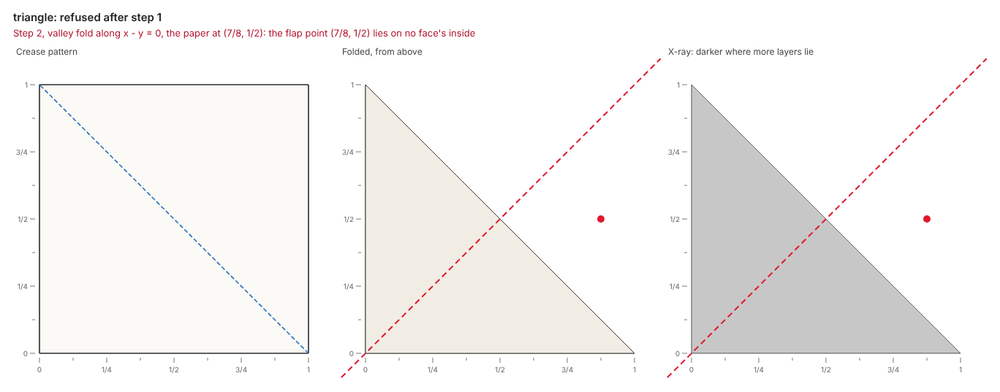

# Get started

The tutorial folds a square in half into a triangle, folds the triangle in half, and reads each build.

## Install

Python 3.14 or newer runs origamy, and a Chromium draws its pictures.
A clone of the repository holds origamy and its examples, and [uv](https://docs.astral.sh/uv/) installs Python and every dependency:

```sh
git clone https://github.com/maxencefaldor/origamy && cd origamy
uv sync                             # Python 3.14 and every dependency, from uv.lock
uv run playwright install chromium  # the browser origamy draws in, once per machine
uv run origamy --version            # the installed version
```

Playwright's Chromium draws the pictures.
The command `uv run playwright install --with-deps chromium` also installs the browser's system libraries on Linux.
The variable `ORIGAMY_RENDER_BROWSER` names a Chromium already on the machine, which then draws instead of Playwright's.

## Write a fold script

A fold script is a Python file whose `fold()` returns a `Paper`.
Create a folder `models/` in the clone and save this script as `models/triangle.py`:

```python title="models/triangle.py"
from origamy import Line, Paper


def fold() -> Paper:
    paper = Paper.square()
    diagonal = Line.through((1, 0), (0, 1))
    paper.valley(diagonal, flap=("3/4", "3/4"))
    middle = Line.through((0, 0), ("1/2", "1/2"))
    paper.valley(middle, flap=("3/4", "1/8"))
    return paper
```

The call `Paper.square()` makes a square of paper from (0, 0) to (1, 1), its front up.
Coordinates are where the paper lies now, seen from above: x to the right, y up.
Numbers are exact: text such as `"3/4"` reads as a fraction, and a float such as `0.75` stops the script with a `TypeError`.

Each fold takes a line and a flap point.
The paper at the flap point turns over the line, with everything joined to it on that side.
A valley fold turns the paper toward the viewer, so the paper it moves lands on top.
The first fold turns the top right half of the square down over the diagonal, onto the bottom left half: a triangle.
The second fold turns the triangle's right half over the line through (0, 0) and (1/2, 1/2), onto its left half.

## Build it

```sh
uv run origamy build models/triangle.py
```

The build runs the script in a process of its own, folds the paper one action at a time, and draws every step.
The report counts the steps the paper took and lists the files the build wrote:

```text
triangle.py: 2 steps folded
wrote models/triangle.fold, models/triangle.png, models/triangle.steps.png, models/triangle.html
```

The picture `models/triangle.png` shows the paper at the end: the crease pattern, the folded paper from above, and an x-ray.
The crease pattern draws valleys as blue dashes and mountains as red dashes and dots.
Creases read from the paper's front: the second crease is a valley in the bottom layer and a mountain in the top one.
The folded view paints each face in the color of its side up, here the cream back.
The x-ray darkens where more layers lie, and four layers lie everywhere here.



The picture `models/triangle.steps.png` shows every step, each with the next fold line dashed, as diagrams do.

## Read a refusal

The paper refuses an action it cannot take, and the build stops at that script line.
Change the second flap point to (7/8, 1/2), a point of the square the first fold moved:

```python
paper.valley(middle, flap=("7/8", "1/2"))
```

Build again:

```text
triangle.py: 1 step folded, then step 2 refused
error[flap-off-paper] step 2, valley fold along x - y = 0, the paper at (7/8, 1/2): models/triangle.py:9 in fold(): the flap point (7/8, 1/2) lies on no face's inside
wrote models/triangle.fold, models/triangle.png, models/triangle.steps.png, models/triangle.html
```

The refusal states one fact: no paper lies at the flap point.
The rule in brackets, `flap-off-paper`, names the fact, and `models/triangle.py:9` names the script line that asked for the fold.
The first fold moved the paper that lay at (7/8, 1/2) to (1/2, 1/8), and coordinates name where the paper lies now.
The picture shows the paper just before the refused action, with its fold line dashed in red and its flap point as a red dot:



Restore the flap point (3/4, 1/8), and the build folds both steps again.

## Open the viewer

The build also writes `models/triangle.html`, a standalone page that replays the fold in 3D.
Open the page in a browser: the crease pattern sits beside the folded paper, and the arrow keys step through the fold.
The page loads three.js from jsDelivr, so it needs a network connection but no server.
The [Pictures](guide/pictures.md#the-3d-viewer) page lists what the viewer offers.

## Next steps

Four sections of the docs go further than the tutorial:

<div class="grid cards origamy-links" markdown>

-   📘 **[Guide](guide/index.md)**

    Each step of the tutorial in depth, one concept per page, starting with coordinates.

-   🤖 **[Agents](agents/index.md)**

    Hand the loop to an agent through the command line, the MCP server or the skill.

-   🖼️ **[Gallery](gallery.md)**

    The example models in the 3D viewer, each with its fold script.

-   📚 **[Reference](reference/index.md)**

    Every command and rule, including the ones the tutorial met.

</div>
