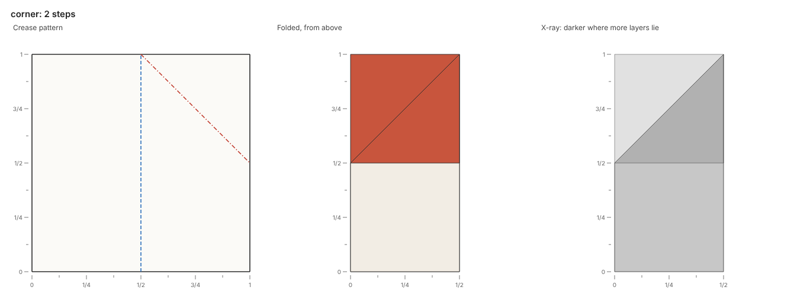

# Actions

Each action asks the paper to fold, unfold or turn over, and the paper takes it or refuses it.

| Action | Does |
| --- | --- |
| `valley(line, flap, layers=None)` | Turns the paper at `flap` over `line`, toward the viewer |
| `mountain(line, flap, layers=None)` | Turns the paper at `flap` over `line`, away from the viewer |
| `unfold(line, flap, layers=None)` | Turns the paper at `flap`, folded along `line`, back the way it came |
| `precrease(line, flap, layers=None, mountain=False)` | Folds and unfolds, leaving creases along `line` in the paper it takes |
| `turn_over()` | Turns the paper over, from left to right |
| `collapse(...)`, `reverse(...)`, `petal(...)` | Folds many creases at once (see [Collapses](collapses.md)) |

## Folds

A fold takes a line and a flap point, the point at which it takes the paper to move.
The paper at the flap point turns over the line, with everything joined to it on that side.
The crease between paper that moves and paper that stays is a hinge, and it lies along the fold line.
A fold cuts each face it moves along the line, which leaves a crease there.

A valley fold turns the paper toward the viewer, and a mountain fold turns it away.
A valley fold lands the moved paper on top of the paper it meets, and a mountain fold lands it underneath.
The paper that stays keeps its order, and the paper that moves reverses its own.
The layer solver then finds how every face stacks, as the [Feedback](feedback.md#the-layer-solver) page explains.

The flap point must lie inside the paper and off the fold line.
The paper refuses a fold whose flap point lies on no face's inside (`flap-off-paper`), or on the line itself (`flap-on-line`).
The paper also refuses a fold whose moving paper meets no other paper along the line (`no-hinge`).

## Layers

A layer is one face at a point, and the query `paper.layers(point)` counts the layers there.
A fold without `layers` takes all the paper on the flap point's side of the line.
The argument `layers=n` takes the top n layers at the flap point instead, with everything joined to them on that side.
The paper refuses a fold that asks for more layers than lie at the flap point (`too-few-layers`).

The fold script below folds a square in half, then folds the top layer's corner down along the line from (0, 1/2) to (1/2, 1):

```python title="models/corner.py"
from origamy import Line, Paper


def fold() -> Paper:
    paper = Paper.square()
    paper.valley(Line.through(("1/2", 0), ("1/2", 1)), flap=("3/4", "1/2"))
    corner = Line.through((0, "1/2"), ("1/2", 1))
    paper.valley(corner, flap=("1/8", "7/8"), layers=1)
    return paper
```

The top layer's corner lands front up, and the bottom layer's corner stays where it lay.
One layer then lies at (1/8, 7/8), and three lie at (3/8, 5/8).
The same fold without `layers=1` takes both layers, and no paper lies at (1/8, 7/8) afterward.



## Unfolds

The action `unfold(line, flap)` turns the paper at `flap`, folded along `line`, back the way it came.
An unfold without `layers` takes the upper side of every fold along the line, on the flap point's side.
The paper refuses an unfold along paper that lies flat there, or along a line through the inside of a face (`not-folded`).
The paper also refuses a fold about a crease already folded that way (`already-folded`).

## Precreases

A precrease folds and unfolds, leaving creases along the line in the paper it takes.
The fold is a valley fold unless the argument `mountain=True` makes it a mountain fold.
The paper must be able to take the fold, so a refused fold refuses the precrease.
Precreases prepare [collapses](collapses.md), which fold creases already in the paper.

## Turning over

The action `turn_over()` turns the paper over from left to right, about the middle of what it covers.
The stacking reverses, and each face shows its other side.
The [cup example](https://github.com/maxencefaldor/origamy/blob/main/examples/cup.py) folds its front flap down, turns the paper over, and folds the back flap the same way:

```python
for _ in range(2):
    corner, left, right = (paper.where(p) for p in (a, b, c))
    rim = Line.through(left, right)
    paper.valley(rim, flap=midpoint(corner, midpoint(left, right)), layers=1)
    paper.turn_over()
```

## Queries

Queries read the paper and change nothing, so a script can find its next fold from the paper as it lies:

| Query | Returns |
| --- | --- |
| `layers(at)` | How many layers lie at a point |
| `where(point)` | Where a point of the unfolded paper lies now, such as a corner |
| `origin(at, layer=1)` | Where a point of a layer lies on the unfolded paper, the top layer first |
| `creases(along, at=None, layers=None)` | The creases lying along a line now, as segments of the crease pattern |

The argument `at` of `creases` keeps only the creases of the top `layers` layers at a point.
Each layer counts with the paper it continues into across flat creases.
The session below folds a square in half twice:

```pycon
>>> from origamy import Line, Paper
>>> paper = Paper.square()
>>> paper.valley(Line.through(("1/2", 0), ("1/2", 1)), flap=("3/4", "1/2"))
>>> paper.valley(Line.through((0, "1/2"), ("1/2", "1/2")), flap=("1/4", "3/4"))
>>> paper.layers(("1/4", "1/4"))
4
>>> print(paper.where((1, 1)))
(0, 0)
>>> print(paper.origin(("1/8", "1/8")))
(1/8, 7/8)
>>> print(paper.origin(("1/8", "1/8"), layer=4))
(1/8, 1/8)
>>> for start, end in paper.creases(Line.through((0, "1/2"), (1, "1/2"))):
...     print(start, end)
(1, 1/2) (1/2, 1/2)
(1/2, 1/2) (0, 1/2)
>>> paper.turn_over()
>>> print(paper.where((1, 1)))
(1/2, 0)
```

The corner (1, 1) lies at (0, 0) after both folds, and at (1/2, 0) once the paper turns over.
