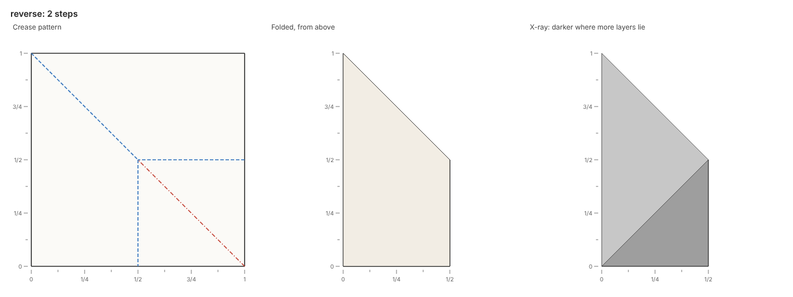

# Collapses

A collapse folds, unfolds or reverses many creases at once, and the paper follows.

## Collapse

The action `collapse(valleys=..., mountains=..., flats=..., fixed=...)` sets creases already in the paper.
Each crease is a whole line of the crease pattern, or a segment of one given by its two ends.
A line or segment takes every crease of the paper along it.
The paper refuses a collapse that names a line or segment with no crease along it (`no-crease`).
Valleys and mountains read as on the crease pattern, from the paper's front.
Creases in `flats` lie flat afterward, and every other crease keeps its state.

The top face at the point `fixed` stays where it lies, and the largest face stays when the script names no `fixed` point.
Each other face lies where the creases between it and the fixed face put it.
The [preliminary base](https://github.com/maxencefaldor/origamy/blob/main/examples/preliminary_base.py) precreases four lines through the center, then collapses them in one step:

```python title="examples/preliminary_base.py"
# Copyright 2026 Maxence Faldor
"""The preliminary base: four creases through the center, collapsed at once."""

from origamy import Line, Paper


def fold() -> Paper:
    """Precrease both diagonals and both middle lines, then collapse."""
    paper = Paper.square()
    rising = Line.through((0, 0), (1, 1))
    falling = Line.through((1, 0), (0, 1))
    upright = Line.through(("1/2", 0), ("1/2", 1))
    level = Line.through((0, "1/2"), (1, "1/2"))
    paper.precrease(rising, flap=("3/4", "1/4"))
    paper.precrease(falling, flap=("7/8", "5/8"), mountain=True)
    paper.precrease(upright, flap=("3/4", "1/8"))
    paper.precrease(level, flap=("1/8", "3/4"))

    # Four valleys and two mountains meet at the center; the rising diagonal stays
    # flat, inside the flaps.
    paper.collapse(valleys=[upright, level], mountains=[falling], fixed=("7/8", "5/8"))
    return paper
```

## Segments

A segment names part of a line, so a line can be a valley on one side of a vertex and a mountain on the other.
The fold script below collapses a square into a quarter in one step, then unfolds the second fold:

```python title="models/quarter.py"
from origamy import Line, Paper


def fold() -> Paper:
    paper = Paper.square()
    upright = Line.through(("1/2", 0), ("1/2", 1))
    level = Line.through((0, "1/2"), (1, "1/2"))
    paper.precrease(upright, flap=("3/4", "1/4"))
    paper.precrease(level, flap=("1/4", "3/4"))
    paper.collapse(
        valleys=[upright, ((0, "1/2"), ("1/2", "1/2"))],
        mountains=[(("1/2", "1/2"), (1, "1/2"))],
        fixed=("1/4", "1/4"),
    )
    top = Line.through((0, "1/2"), ("1/2", "1/2"))
    paper.collapse(flats=paper.creases(top))
    return paper
```

Collapses name creases on the crease pattern, while the paper lies folded.
Two queries bridge the two.
The query `paper.creases(line)` gives the crease pattern segments lying along a line now.
The query `paper.origin(point)` gives where a point of the top layer lies on the unfolded paper.
The last collapse unfolds every crease along the quarter's top edge, so the paper ends folded in half.

## Vertices and stacking

A collapse checks every vertex inside the paper before it folds:

| Rule | Condition at each vertex with folds |
| --- | --- |
| `mountain-valley-count` | The numbers of mountain and valley folds differ by exactly two (Maekawa's theorem) |
| `unbalanced-angles` | The alternate angles between folds each sum to 180° (Kawasaki-Justin theorem) |

Two crossing diagonals, both valleys, put four valleys and no mountain at the center:

```text
maekawa.py: 2 steps folded, then step 3 refused
error[mountain-valley-count] step 3, collapse 2 valleys, 0 mountains and 0 flat creases: models/maekawa.py:10 in fold(): 0 mountains and 4 valleys meet at (1/2, 1/2)
  faces: 0, 1, 2, 3
1 layer at most, at (5/6, 1/2)
wrote models/maekawa.fold, models/maekawa.png, models/maekawa.steps.png, models/maekawa.html
```

The layer solver then finds how the faces stack, or the paper refuses the collapse (see [Feedback](feedback.md#the-layer-solver)).
A collapse moves the paper as little through itself as it can: each face that turns about a fold lands beside the face across it.
Faces that overlapped keep their order, reversed where they moved together and the move turned them over.

## Named moves

A named move computes its creases and collapses in one step, judged like any collapse:

| Move | Does |
| --- | --- |
| `reverse(line, flap, layers=None, outside=False)` | Turns the tip of a folded flap inside out between its two halves; `outside=True` wraps it around them |
| `petal(line, flap)` | Lifts the top layer over a line while its sides fold in along precreased creases |

### Reverse folds

The tip of a reverse fold is the paper at the flap point on its side of the line, taken as a fold takes it.
The tip opens into an upper and a lower half, each one piece of paper, joined only by folds.
The folds between the halves are the tip's spine.
Each half turns over the line as one, and the upper half stays above the lower.
An inside reverse fold tucks each half's tip between the halves, and an outside reverse fold wraps it around them.

The fold script below folds a square into a triangle, then reverse folds its right tip inside, between the two layers:

```python title="models/reverse.py"
from origamy import Line, Paper


def fold() -> Paper:
    paper = Paper.square()
    paper.valley(Line.through((1, 0), (0, 1)), flap=("3/4", "3/4"))
    paper.reverse(Line.through(("1/2", 0), ("1/2", 1)), flap=("3/4", "1/8"))
    return paper
```

The spine, the triangle's long edge, turns inside out: its stretch beyond x = 1/2 becomes a mountain on the crease pattern.



A tip can split in several ways, and the reverse fold takes the split that divides the layers at the flap point most evenly.
The paper refuses a tip that opens in no way (`no-spine`), or in several equally even ways (`several-spines`).
A reverse fold of flat paper finds no spine:

```text
flat_reverse.py: 0 steps folded, then step 1 refused
error[no-spine] step 1, inside reverse fold along x = 1/2, the paper at (3/4, 1/8): models/flat_reverse.py:6 in fold(): the paper to reverse at (3/4, 1/8) opens into two halves in no way
  faces: 0
1 layer at most, at (1/2, 1/2)
wrote models/flat_reverse.fold, models/flat_reverse.png, models/flat_reverse.steps.png, models/flat_reverse.html
```

The [crane](https://github.com/maxencefaldor/origamy/blob/main/examples/crane.py) reverse folds its neck, tail and head, each taking every layer at its flap point:

```python
paper.reverse(line, flap=flap, layers=paper.layers(flap))
```

### Petal folds

A petal fold lifts the top layer at the flap point over the line, with every face it continues into across flat creases.
The layer's creases along the line fold toward the viewer.
The creases that run from where the line meets the layer's folded sides into the lifted region fold the same way.
Their partners, in the layer joined across each side, fold too, and the sides between them open flat.
The script must precrease these creases first.

The paper refuses a petal fold with no flat crease of the layer along its line (`no-crease`), or with no folded side to open (`no-side`).
The [bird base](https://github.com/maxencefaldor/origamy/blob/main/examples/bird_base.py) precreases the kite creases and the top on each side of a preliminary base, then petal folds:

```python
paper.precrease(kite_left, flap=inside_left, layers=1)
paper.precrease(kite_right, flap=inside_right, layers=1)
# Fold the top down over the kites and back, then lift the open corner up
# along that crease, the sides folding in.
top = Line.through(top_left, top_right)
middle = meet(top, Line.through(center, corner))
near_center = midpoint(midpoint(center, top_left), midpoint(center, middle))
paper.precrease(top, flap=near_center)
paper.petal(top, flap=midpoint(corner, midpoint(top_left, middle)))
```


