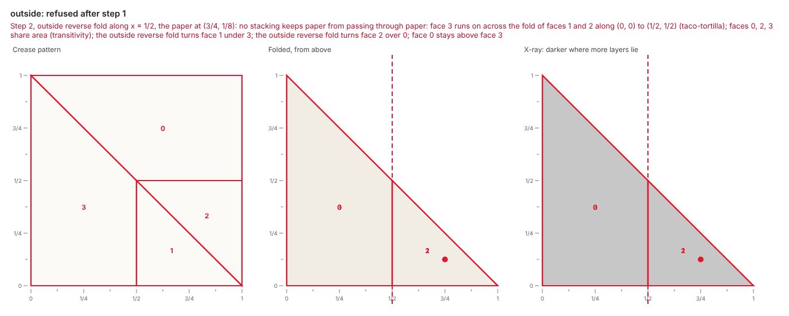

# Feedback

Every build states facts about its steps: what happened and why, never how to fix it.

## Facts, not advice

Each fact names its rule, the step, the script line behind the step, and the faces involved.
Deciding what to change stays with the agent: origamy never fixes a script and never suggests a fix.
Advice belongs in a skill, such as the [fold-model skill](../agents/connect.md#skill).

The fold script below folds a square in half, then folds along a line that misses the paper:

```python title="broken.py"
from origamy import Line, Paper


def fold() -> Paper:
    paper = Paper.square()
    paper.valley(Line.through(("1/2", 0), ("1/2", 1)), flap=("3/4", "1/2"))
    paper.valley(Line.through((2, 0), (2, 1)), flap=("1/4", "1/2"))
    return paper
```

```text
broken.py: 1 step folded, then step 2 refused
warn[unreferenced-fold] step 2, valley fold along x = 2, the paper at (1/4, 1/2): broken.py:7 in fold(): no point or line on the paper locates the fold line x = 2
error[no-hinge] step 2, valley fold along x = 2, the paper at (1/4, 1/2): broken.py:7 in fold(): the paper to move meets no other paper along x = 2
  faces: 0, 1
wrote broken.fold, broken.png, broken.steps.png, broken.html
```

Each fact has four parts:

1. **The level and the rule**: `error[no-hinge]`.
1. **The step**, with its action, its fold line and its flap point: `step 2, valley fold along x = 2, the paper at (1/4, 1/2)`.
1. **The script line** that asked for the action: `broken.py:7 in fold()`.
1. **The fact**: `the paper to move meets no other paper along x = 2`.

The line `faces:` lists the faces the fact is about, numbered as the pictures label them.

## Refusals

A refusal is an action the paper cannot take, with the facts of why.
The paper has no state after a refused action, so the build stops at that script line.
The report counts the steps the paper took, then states the refusal.
The picture `name.png` shows the paper just before the refused action, its fold line dashed in red and its flap point a red dot.
The picture outlines the faces of the refusal in red and labels them with their numbers.
A refused action may have cut the paper along its line before its refusal, so its faces are faces of the cut paper.

## Warnings

A warning states a fact about a step the paper takes, and the build goes on.
The warning `unreferenced-fold` states that no point or line already on the paper locates a fold line (see [Coordinates](coordinates.md#lines-the-paper-locates)).
The command `origamy build` exits with status 1 when the paper refuses an action or the script fails, and 0 otherwise, warnings included.

## Rules

Each rule has a name, a level and an exact condition.
A refusal rule stops the action it states, so it is always an error:

| Rule | Level | Fact |
| --- | --- | --- |
| `flap-off-paper`, `flap-on-line` | error | The flap point names no paper to move |
| `too-few-layers` | error | Fewer layers lie at the flap point than the action takes |
| `no-hinge` | error | The paper to move is joined to no other paper along the fold line |
| `already-folded`, `not-folded` | error | A fold turns a crease already folded that way, or an unfold turns flat paper |
| `no-crease` | error | A collapse names a line with no crease of the paper along it |
| `no-spine`, `several-spines` | error | A reverse fold's tip opens into two halves in no way, or in several equally even ways |
| `no-side` | error | The layer a petal fold lifts has no folded side to open |
| `mountain-valley-count` | error | Mountains and valleys at a vertex do not differ by two |
| `unbalanced-angles` | error | The angles between folds at a vertex do not alternate to 180° |
| `layer-crossing` | error | No stacking of the faces keeps paper from passing through paper |
| `layer-order-unknown` | error | The layer solver stopped before finding a stacking |
| `not-flat` | error | The action folds paper that shaping has turned out of the plane |
| `hinge-bent` | error | The hinge of a shape step runs through paper turned apart before |
| `turns-through-paper` | error | A shape step turns paper through paper that stays |
| `unreferenced-fold` | warn | No point or line already on the paper locates the fold line |

The [rules](../reference/rules.md) page gives every rule's exact condition.
The command `origamy explain` prints every rule, and `origamy explain no-hinge` prints one:

```text
no-hinge (error, refuses the action)
  The paper to move is joined to no other paper along the fold line.
  The faces an action moves meet the faces that stay along no edge on the fold line; the action would turn that paper over, not fold it.
```

## The layer solver

The state of the paper is its crease pattern, the place of each face, and the stacking.
The stacking says which face is above, wherever two faces overlap.
The layer solver finds the stacking after each fold, unfold and collapse, so that no paper passes through paper.
The solver has one variable for each pair of overlapping faces: which one is above.
Four kinds of constraint, after Akitaya, Demaine and Ku's [Flat-Folder](https://erikdemaine.org/papers/FlatFolder_OSME2024/paper.pdf), say exactly when a stacking is valid:

| Constraint | Says |
| --- | --- |
| `taco-taco` | Two folds along one stretch of line, their faces on the same side, nest or stack but never interleave |
| `taco-tortilla` | Paper that runs on across a fold stays outside the fold |
| `tortilla-tortilla` | Two pieces of paper creased flat along one stretch of line keep the same order on both sides of it |
| `transitivity` | Three faces that share area stack with no cycle |

The solver propagates these constraints and searches, keeping the reason for each deduction.
The paper refuses an action that leaves no valid stacking (`layer-crossing`), and the message names the constraints and orders that conflict.
The solver gives up after 100,000 dead ends, and the paper then refuses the action (`layer-order-unknown`).

The paper takes the inside reverse fold of the [Collapses](collapses.md#reverse-folds) page, and refuses the same fold with `outside=True`:

```text
outside.py: 1 step folded, then step 2 refused
error[layer-crossing] step 2, outside reverse fold along x = 1/2, the paper at (3/4, 1/8): models/outside.py:7 in fold(): no stacking keeps paper from passing through paper: face 3 runs on across the fold of faces 1 and 2 along (0, 0) to (1/2, 1/2) (taco-tortilla); faces 0, 2, 3 share area (transitivity); the outside reverse fold turns face 1 under 3; the outside reverse fold turns face 2 over 0; face 0 stays above face 3
  faces: 0, 1, 2, 3
wrote models/outside.fold, models/outside.png, models/outside.steps.png, models/outside.html
```

The tip's spine would land along the line from (0, 0) to (1/2, 1/2).
Face 3 stays where it lies and runs on across that line, so the tip's two halves cannot wrap around it.


