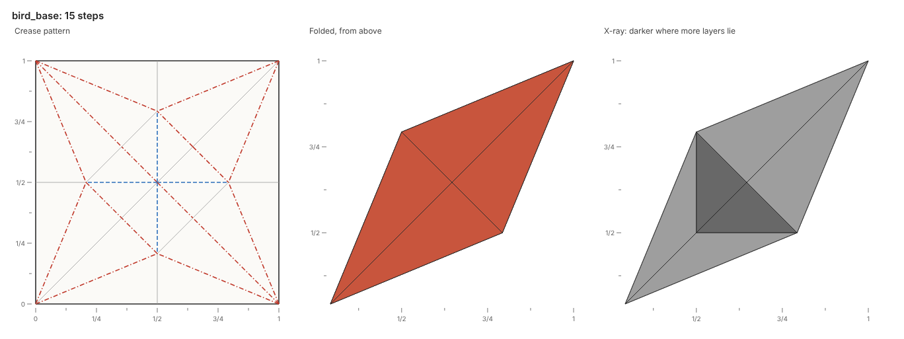
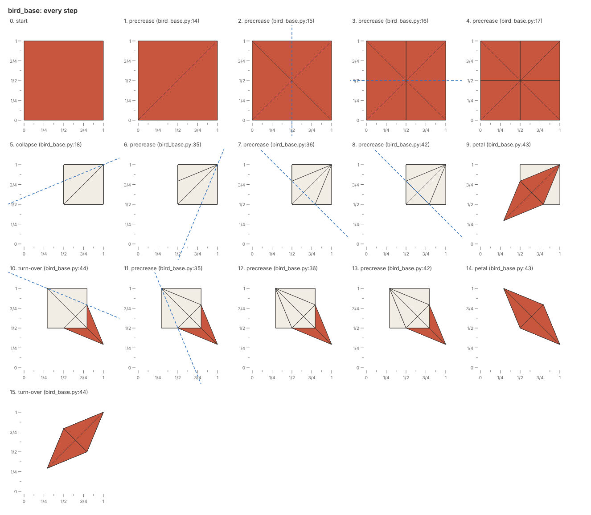
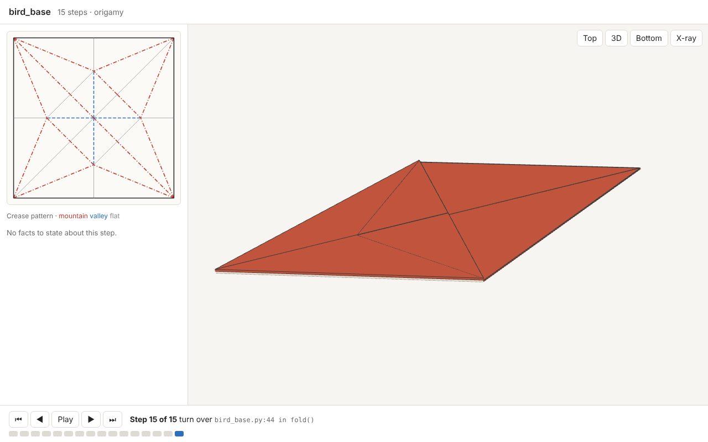

# Pictures

The report states what happened, and the pictures, drawn by every build, show whether the paper looks as intended.

## The overview

A build writes `name.png` beside the script: the paper at the end, or just before a refused action.
The title gives the model's name and its number of steps, or the step after which the paper refused an action.
Three views sit side by side:

| View | Shows |
| --- | --- |
| Crease pattern | The unfolded paper with every crease: mountains in red dashes and dots, valleys in blue dashes, flat creases in gray |
| Folded, from above | The folded paper, each face in the color of its side up: the front vermilion, the back cream |
| X-ray | Every layer at once, darker where more layers lie |

Once [shaping](shaping.md) turns the paper out of the plane, the middle view shows it in space instead, seen from in front and above.

Each view carries rulers along its bottom and left sides, ticked every eighth of the paper's longer side and labeled every quarter.
A coordinate read off the folded view's rulers is a coordinate to write in the fold script.

## The x-ray

The x-ray draws every face faintly, so the paper darkens where more layers lie.
The x-ray shows what the folded view hides, such as a reverse fold's tip tucked between two layers.

## Every step

A build also writes `name.steps.png`: the folded paper after every step, from the unfolded paper to the last step.
Each picture names its step's action and script line, and dashes the next fold line in blue, as diagrams do.
A collapse has no single fold line, so the picture before a collapse dashes none.

## Marks

Marks show on the pictures what the report states in text:

| Mark | Means |
| --- | --- |
| Red dashed line | The fold line of the refused action |
| Red dot | The flap point of the refused action |
| Red outline and number | A face of the refusal, with its number |
| Blue dashed line | The next fold, in the picture of every step |
| Red note under the title | The refused step and its fact |

## The 3D viewer

A build writes `name.html`, a standalone page that replays the fold step by step in 3D.
The page holds the build as data and loads three.js from jsDelivr, so it needs a network connection but no server.
The crease pattern sits beside the folded paper, and each step's motion animates.
A fold turns its paper about the fold line, and a collapse, reverse fold or petal fold turns its creases together, as rigid origami, so the paper stays whole on the way.
Layers sit a small gap apart, and a fold's crease bends round from one layer to the other, so a folded edge reads as one sheet.

| Control | Does |
| --- | --- |
| Drag, right-drag, scroll | Orbit, pan and zoom |
| Top, 3D, Bottom | Look from above, from a tilt, or from below |
| X-ray | See through the layers |
| ⏮ ◀ Play ▶ ⏭ | The first step, the previous one, play, the next one and the last; the keys Home, ←, Space, → and End do the same |
| Dots | Each step, to jump to it; a step with facts is yellow, and a refused step red |
| Hover | Lights a face in the 3D view and on the crease pattern at once |

Each step names its action, its fold line and its script line, and the panel beside the crease pattern lists its facts.
The crease pattern tints in blue the faces a step moved, when the step moved only part of the paper.
