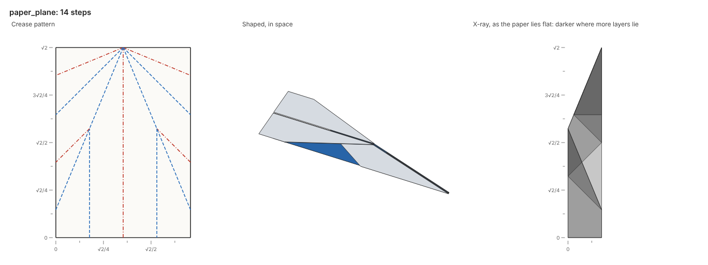

# Shaping

Folding presses every crease flat.
Shaping then opens folds part of the way, as hands spread a crane's wings or level a plane's.
Shaped paper leaves the table: the pictures, the viewer and the FOLD file show it in space.

| Action | Does |
| --- | --- |
| `shape(line, flap, angle, layers=None)` | Turns the paper at `flap` about `line` by `angle` degrees, as one rigid piece |
| `flex({crease: angle, ...}, fixed=None)` | Folds creases to angles, and the other creases follow as rigid origami |
| `tilt(line, flap, angle)` | Turns the whole paper about `line` on the table by `angle` degrees |
| `turn_over()` | Turns the paper over, keeping its form in space |

## Shape steps

A shape step takes the paper as a fold does: the top `layers` layers at the flap point, with everything joined to them on that side of the line.
The paper taken turns about its hinge, the crease along the line between it and the paper that stays.
A positive angle turns it up, toward the viewer, and a negative angle turns it down.
A turn of 180° on a fold opens it flat, and a turn of 90° stands it square.

Lines and points read in the paper as it lies flat, so `paper.where` still names them after shaping.
A shape step about a line with no crease along it bends the paper there, as a fold would.
The [paper plane](https://github.com/maxencefaldor/origamy/blob/main/examples/paper_plane.py) holds one wing and turns its body down, then turns the other wing level:

```python
paper.turn_over()
for crease, flap, layers in (("1/4", ("3/8", "1/8"), 3), ("3/4", ("7/8", "1/8"), 1)):
    line = Line.through(paper.where((crease, 0)), paper.where((crease, "1/2")))
    paper.shape(line, flap=paper.where(flap), angle=90, layers=layers)
paper.turn_over()
```



## Flexes

A shape step turns one piece of paper about one hinge.
Creases that meet at a vertex inside the paper close a loop, and they turn only together.
A flex folds the creases it names to their angles, and every other crease follows.

Each crease is a line of the crease pattern, or a segment of one, and takes every crease along it, as in a collapse.
Each crease folds its own way to the angle named: 180 pressed flat, 0 open flat, and a negative angle the other way.
A crease lying flat folds as a valley.
The top face at `fixed` stays where it lies, and the largest face stays when the script names no point.

Every face stays rigid, so the paper moves as rigid origami.
Around each vertex inside the paper, the turns about its creases undo one another.
A solver follows the named creases to their angles in steps of 2°, and turns the other creases as little as closes every loop.
The preliminary base opens its four valleys to 120° in one flex:

```python
paper.flex({upright: 120, level: 120})
```

## Tilts

A tilt holds a finished model up to show it.
The whole paper turns about a line on the table, and the side of the line where the flap point lies rises.
The line reads in the coordinates of the paper as it lies flat, which match the table wherever shaping has turned no paper.
The [crane](https://github.com/maxencefaldor/origamy/blob/main/examples/crane.py) spreads each wing level, then stands up on its shoulders, its tail's side rising:

```python
for tip, inside in wings:
    paper.shape(shoulders(paper, tip), flap=paper.where(inside), angle=90, layers=1)
    paper.turn_over()
paper.tilt(shoulders(paper, (0, 0)), flap=paper.where((1, 0)), angle=90)
```

## Settling

A settle step turns creases toward angles and lets the paper bend as it must, as pleats curl a sheet into a saddle.
The simulator turns the creases and lets the paper settle on the table under its weight, its faces free to bend.

```python
paper.settle(dict.fromkeys(pleats, 90))
```

Each crease is named as a flex names it, and turns its own way: 180 pressed flat, 0 open flat.
The build keeps the exact paper as it was before the step.
Only the simulator, and the viewer's film that plays it, show the settled paper.
Paper that shaping stood up keeps its pose as it settles: it bends in place rather than falling over.
A settle step ends the build: the paper refuses any action after it.

The simulator keeps no thickness, and orders keep its layers in their stacking only at a few points of each triangle.
Settled layers can therefore pass through each other, so settling suits a crease pattern on open paper.
Each stage of a simulation measures how deep its paper passes through itself, and the gallery plays no film whose settled paper does.

## Rules

Shaped paper takes shape steps, flexes, tilts and turning over, and no more folds.

| Rule | Refuses |
| --- | --- |
| `not-flat` | A fold, unfold, precrease, collapse or named move after a shape step, a flex or a tilt |
| `hinge-bent` | A shape step whose hinge runs through paper an earlier shape step turned apart |
| `turns-through-paper` | A shape step that turns paper through paper that stays, or a flex that folds a crease past flat or passes faces through each other |
| `no-flex` | A flex whose angles no rigid motion of the faces reaches |
| `flap-on-line` | A tilt whose flap point lies on its line, and so names no side |
| `settled` | Any action after a settle step |

Shape steps and flexes keep every face rigid.
A cup's mouth opens only as its paper bends, so a flex that opens it is refused.

## In pictures, the viewer and FOLD files

Pictures draw shaped paper in space, nearer faces over farther ones, each in the color of the side it shows.
The eye sits in front of the model and above it, square to its longest reach on the table.
The x-ray still shows the paper as it lies flat, where every layer and stacking stays exact.

The viewer turns each shaped face about its step's axis, follows a flex through the forms it passes, and opens on the model from the same eye as the pictures.
The FOLD file writes a shaped step's folded form in 3D, and every frame gives each crease's fold angle in `edges_foldAngle`.
