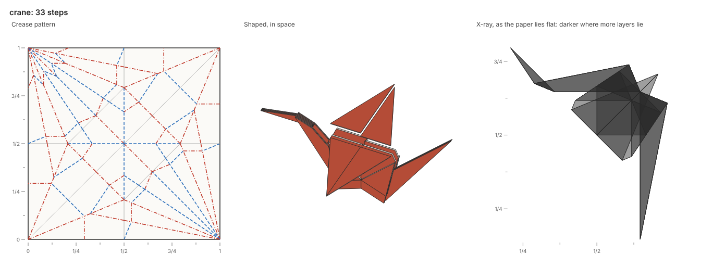
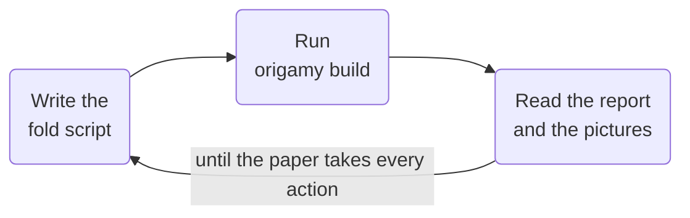
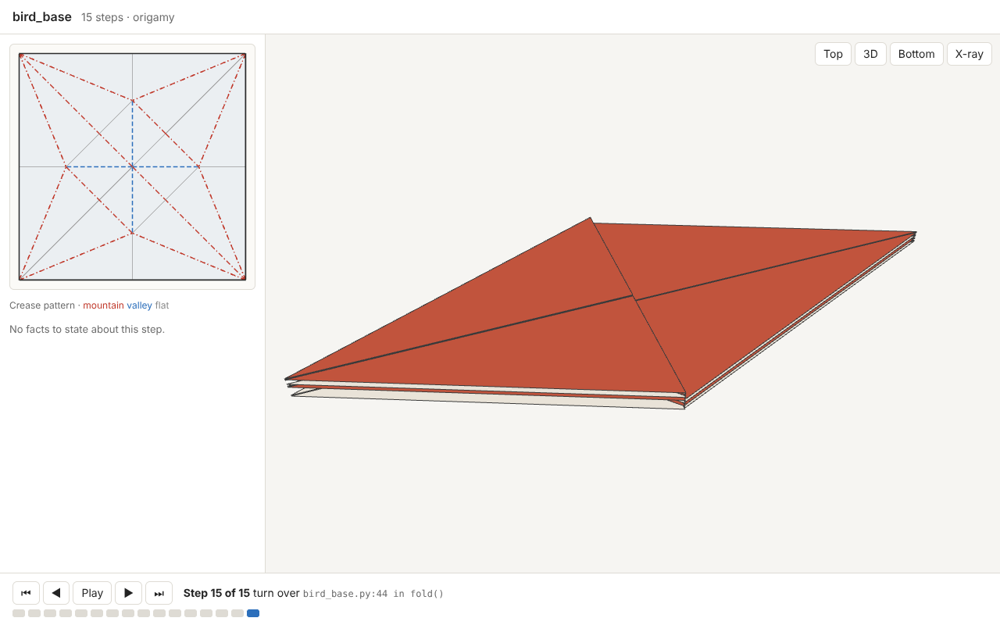

<div class="origamy-hero" markdown>

# origamy

A compiler for origami, built for AI agents.
{ .origamy-tagline }

An agent writes an origami model as a Python fold script, and each build folds it step by step on a simulated sheet.
The paper takes each action or refuses it, with the facts of why and the script line that asked for it.

[Get started](get-started.md){ .md-button .md-button--primary } [Gallery in 3D](gallery.md){ .md-button }

{ .origamy-hero-image }

</div>

<div class="grid cards origamy-links" markdown>

-   📘 **[Guide](guide/index.md)**

    One page per concept: coordinates, fold scripts, actions, collapses, feedback, pictures and exports.

-   🤖 **[Agents](agents/index.md)**

    Connect an agent through the command line, the MCP server or the skill.

-   🖼️ **[Gallery](gallery.md)**

    Every example in the 3D viewer, from a paper cup to the crane and the circular pleat.

-   📚 **[Reference](reference/index.md)**

    Every command, rule and Python function.

</div>

## How it works

Each build runs the fold script, folds the paper one action at a time, and draws every step.
The agent reads the report and the pictures, edits the script and builds again.
The loop ends when the paper takes every action and the pictures show the intended model.



Coordinates are exact numbers built from the rationals by square roots, so every check is exact.
The 22.5° angles of the bird base and the 11.25° creases of the crane stay exact, as does the bisector of any angle.
No list of legal moves exists: the agent proposes any action, and the build states what happens.

## The 3D viewer

Every build also writes a standalone page that replays the fold in 3D, beside the crease pattern.
Hovering a face lights it in both views, and each step names its script line and its facts.



## Install

A clone of the repository holds origamy and its examples, and [uv](https://docs.astral.sh/uv/) installs Python if needed.

```sh
git clone https://github.com/maxencefaldor/origamy && cd origamy
uv sync                             # Python 3.14 and every dependency, from uv.lock
uv run playwright install chromium  # the browser origamy draws in, once per machine
```

The [Get started](get-started.md) page writes a first fold script.
One command builds an example, the bird base:

```sh
uv run origamy build examples/bird_base.py
```
